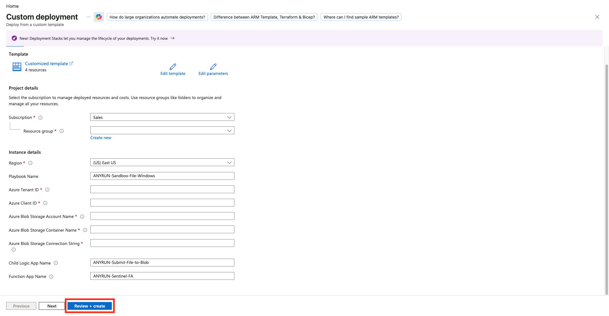

# ANY.RUN — Sandbox File Debian

## Summary

> **Note:** This playbook is required **only** if you need to analyze files from Debian endpoints **and** you do **not** have Microsoft Defender for Endpoint (MDE).  
> If you have MDE, use the [Sandbox-File-Defender](../Sandbox-File-Defender/README.md) playbook instead. It collects files directly via MDE Live Response and does not require the child playbook.

When a Microsoft Sentinel incident is created, this playbook:

- Extracts File and Host entities from the incident.
- Calls the child Logic App `Submit-File-to-Blob` to upload the file from the endpoint to Azure Blob Storage.
- Submits the file to ANY.RUN Sandbox (Debian environment) via the Function App `ANYRUN-Sentinel-FA`.
- Adds a comment to the incident with the analysis verdict, threat score, malware tags, IOC table, and a link to the analysis session.
- Uploads detected IOCs to the Microsoft Sentinel Threat Intelligence portal.

## Prerequisites

Shared prerequisites (Key Vault secret `ANYRUN-APIKey`, App Registration, API permissions, role assignments, and Storage Account) are described in the [solution README](../../README.md).

Additional requirements for this playbook:

- The Function App `ANYRUN-Sentinel-FA` must be deployed in the same subscription and resource group.
- The child Logic App `Submit-File-to-Blob` must be deployed first. Note its name — you will enter it as the **Child Logic App Name** parameter.
- Microsoft Sentinel incidents must contain File (and preferably Host) entities.
- An Automation Rule must be configured to run this playbook when an incident is created.

## Deployment

Click below to deploy Parent Azure Logic App with **Flex Consumption plan**

Enter the parameters required for deploying the Logic App and click **Review + create**.

Description of the required parameters:

| Parameter | Description |
|-----------|-------------|
| PlaybookName | Logic App name (default `ANYRUN-Sandbox-File-Debian`). |
| Azure Tenant ID | Tenant ID for authentication in connections. |
| Azure Client ID | Client ID of the App Registration created for the solution. |
| Azure Blob Storage Account Name | Storage account used to store files before they are submitted to ANY.RUN. |
| Azure Blob Storage Container Name | Container name in the storage account. |
| Azure Blob Storage Connection String | Connection string of the storage account. |
| Child Logic App Name | Name of the deployed `Submit-File-to-Blob` Logic App (default `ANYRUN-Submit-File-to-Blob`). |
| functionAppName | Name of the deployed Function App. |

## Post-deployment

### Authorize API connections

After deployment, open the Logic App and authorize the API connections created by the template:

- **Microsoft Sentinel**
- **Key Vault**
- **Azure Blob Storage**

Edit each connection, sign in, and save.

## Playbook steps

1. The playbook is triggered when a Microsoft Sentinel incident is created.
2. It retrieves File and Host entities from the incident.
3. It calls the child Logic App `Submit-File-to-Blob` to upload the file from the endpoint to Azure Blob Storage.
4. It obtains the ANY.RUN API key from Key Vault.
5. It calls the Function App to submit the file for analysis in ANY.RUN Sandbox (Debian environment).
6. After analysis completes, it adds a comment to the incident containing the verdict, threat score, tags, IOC table, and a link to the analysis session.
7. Detected IOCs are uploaded to the Microsoft Sentinel Threat Intelligence portal.

## Storage Account Configuration

To generate an SAS token for Azure Blob Storage, you need to assign the appropriate role directly to the Logic App.

Open your Storage Account.  
Navigate to **Access Control (IAM)** and click **Add**.

Specify the child Logic App `ANYRUN-Submit-File-to-Blob`.  
Select the following role:

| Name | Description |
| --- | --- |
| Storage Account Contributor | Lets you manage storage accounts, including accessing storage account keys which provide full access to storage account data. |

## Logic App configuration (Optional)

### ANY.RUN Sandbox analysis parameters

ANY.RUN is an interactive online malware analysis service for dynamic and static research of most types of threats using a customizable VM environment. We offer a connector for Microsoft Sentinel, which you can independently adapt to your infrastructure and needs in just a few clicks. You can easily change the parameters used for analyzing the required file.

> Note:  
> You can learn more about the capabilities of ANY.RUN Sandbox by reviewing our [API documentation](https://any.run/api-documentation/).

The main setup and customization of the Logic App is available through the graphical editor (**Development tools** > **Logic app designer**) or the code editor (**Development tools** > **Logic app code view**).

For File analysis — in the following three actions which are responsible for declaring the parameters:
* ANY.RUN general analysis options
* ANY.RUN Debian analysis options

In the ANY.RUN general analysis options action, you can modify parameters that define general, OS-independent options such as analysis duration, virtual machine network settings, privacy, and more.  
In the ANY.RUN Debian analysis options actions, you can modify parameters that affect OS-specific virtual machine settings.

Description of the main parameters:

| Parameter Name | Description |
| --- | --- |
| opt_timeout | Defines the timeout option for the analysis. |
| env_os | Specifies the operating system. |
| env_bitness | Defines the bitness of the operating system. |
| env_version | Sets the version of the operating system. |
| env_type | Specify the environment preset type. |
| opt_automated_interactivity | Controls the automated interactivity (ML) option (changing this is not recommended). |
| auto_confirm_uac | Enables automatic confirmation of Windows UAC requests (changing this is not recommended). |
| run_as_root | Allow the file to run with superuser privileges on Linux. |
| obj_ext_extension | Specify whether to change the file extension to a valid one. |

### Simultaneous Analysis of Objects in ANY.RUN Sandbox

ANY.RUN Sandbox allows users to perform multiple analyses simultaneously (availability and capability depend on your pricing plan). By default, if a Microsoft Sentinel incident contains multiple files, each analysis will run sequentially.

To increase the speed of incident enrichment, you can analyze objects simultaneously. To do this, open `For each - detonate files to ANY.RUN Sandbox` loop > `Settings` and increase the `Degree of parallelism` value.

> Note:  
> To expand your capabilities by upgrading your pricing plan, [contact us](https://app.any.run/contact-us/).
