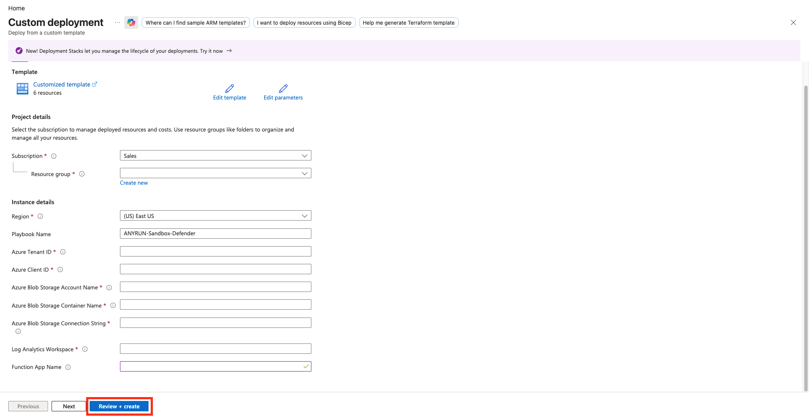
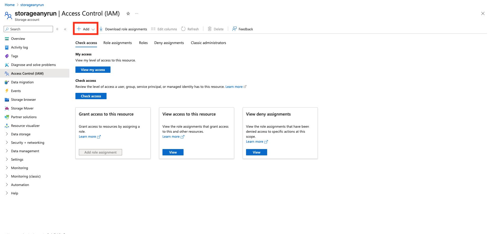
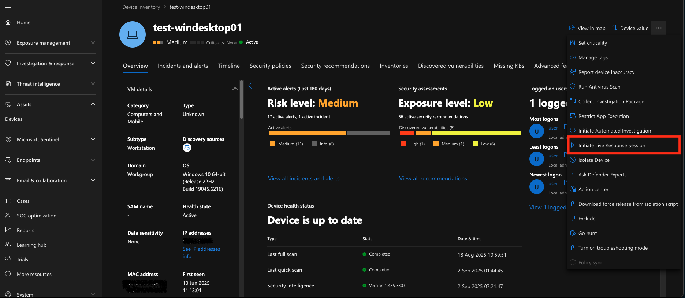
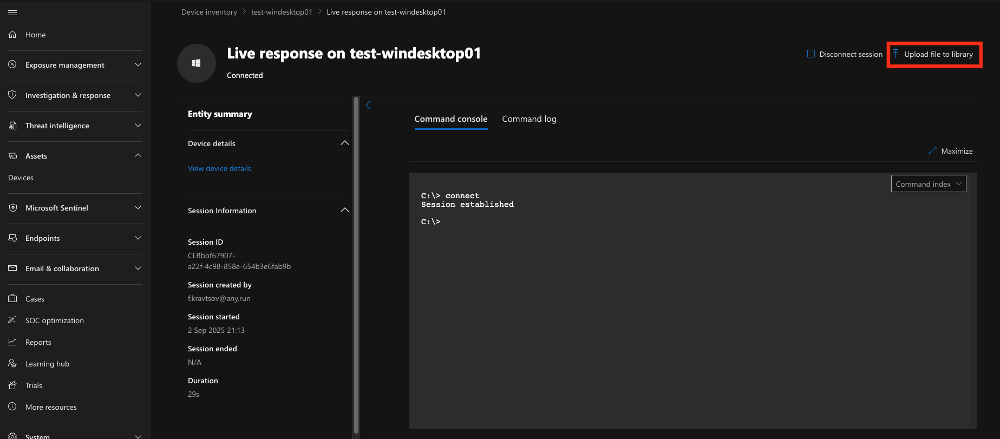

# ANY.RUN — Sandbox File Defender

## Summary

When a Microsoft Sentinel incident is created, this playbook:

- Extracts File, URL, and Host entities from the incident.
- Uses Microsoft Defender for Endpoint (MDE) Live Response to collect files from endpoints and upload them to Azure Blob Storage.
- Submits files and URLs to ANY.RUN Sandbox via the Function App `ANYRUN-Sentinel-FA`.
- Adds a comment to the incident with the analysis verdict, threat score, malware tags, IOC table, and a link to the analysis session.
- Uploads detected IOCs to the Microsoft Sentinel Threat Intelligence portal.

## Prerequisites

Shared prerequisites (Key Vault secret `ANYRUN-APIKey`, App Registration, API permissions, role assignments, and Storage Account) are described in the [solution README](../../README.md).

Additional requirements for this playbook:

- Microsoft Defender for Endpoint must be enabled and devices must be onboarded.
- The Function App `ANYRUN-Sentinel-FA` must be deployed in the same subscription and resource group.
- Microsoft Sentinel incidents must contain File, URL, or Host entities.

## Deployment

Click below to deploy Azure Logic App with **Flex Consumption plan**

Enter the parameters required for deploying the Logic App and click **Review + create**.

Description of the required parameters:

| Parameter | Description |
|-----------|-------------|
| PlaybookName | Logic App name (default `ANYRUN-Sandbox-Defender`). |
| Azure Tenant ID | Tenant ID for authentication in connections. |
| Azure Client ID | Client ID of the App Registration created for the solution. |
| Azure Blob Storage Account Name | Storage account used to store files before they are submitted to ANY.RUN. |
| Azure Blob Storage Container Name | Container name in the storage account. |
| Azure Blob Storage Connection String | Connection string of the storage account. |
| Log Analytics Workspace | Log Analytics workspace name. |
| functionAppName | Name of the deployed Function App. |

## Post-deployment

### Authorize API connections

After deployment, open the Logic App and authorize the API connections created by the template:

- **Microsoft Sentinel**
- **Key Vault**
- **Azure Blob Storage**
- **Azure Monitor Logs**
- **Microsoft Defender for Endpoint (WDATP)**

Edit each connection, sign in, and save.

## Playbook steps

1. The playbook is triggered when a Microsoft Sentinel incident is created.
2. It retrieves File, URL, and Host entities from the incident.
3. For files it uses MDE Live Response to collect the file from the endpoint and upload it to Azure Blob Storage.
4. It obtains the ANY.RUN API key from Key Vault.
5. It calls the Function App to submit files and URLs for analysis in ANY.RUN Sandbox.
6. After analysis completes, it adds a comment to the incident containing the verdict, threat score, tags, IOC table, and a link to the analysis session.
7. Detected IOCs are uploaded to the Microsoft Sentinel Threat Intelligence portal.

## Storage Account Configuration

To generate an SAS token for Azure Blob Storage, you need to assign the appropriate role directly to the Logic App.

Open your Storage Account.  
Navigate to **Access Control (IAM)** and click **Add**.

Specify the Logic App `ANYRUN-Sandbox-Defender`.  
Select the following role:

| Name | Description |
| --- | --- |
| Storage Account Contributor | Lets you manage storage accounts, including accessing storage account keys which provide full access to storage account data. |

## Microsoft Defender for Endpoint configuration and additional script

> **Note:**  
> To allow the connector to extract all files of interest from endpoints (including potentially dangerous ones), we recommend setting **Quarantine** as the default action for your MDE.

### Enable Live Response Sessions

Open your [MDE portal](https://security.microsoft.com).  
Navigate to **System** > **Settings** > **Endpoints** > **General** > **Advanced features**.  
Enable the following settings: **Live Response**, **Live Response for Servers**, and **Live Response unsigned script execution**.

### Upload Helper Scripts to the Local Library of Your Endpoints

Open your MDE portal.  
Navigate to **Assets** > **Devices**.  
Open the required device.  
Click on `...` in the upper right corner and then **Initiate Live Response Session**.

Click **Upload file to library**.

Upload the helper scripts provided with the solution (PowerShell for Windows and shell scripts for Linux) so the playbook can collect files from endpoints.

## Logic App configuration (Optional)

### ANY.RUN Sandbox analysis parameters

The analysis parameters in ANY.RUN Sandbox are defined in the actions of the deployed Logic App.

For URL analysis — **HTTP-RunNewURLAnalysis**  
For File analysis — in the following three actions:
* ANY.RUN general analysis options
* ANY.RUN Windows analysis options
* ANY.RUN Linux analysis options

Description of the main parameters:

| Parameter Name | Description |
| --- | --- |
| opt_timeout | Defines the timeout option for the analysis. |
| env_os | Specifies the operating system. |
| env_bitness | Defines the bitness of the operating system. |
| env_version | Sets the version of the operating system. |
| env_type | Specify the environment preset type. |
| opt_automated_interactivity | Controls the automated interactivity (ML) option (changing this is not recommended). |
| auto_confirm_uac | Enables automatic confirmation of Windows UAC requests (changing this is not recommended). |
| run_as_root | Allow the file to run with superuser privileges on Linux. |
| obj_ext_extension | Specify whether to change the file extension to a valid one. |

See the [ANY.RUN API documentation](https://any.run/api-documentation/) for the full list of parameters.

### Simultaneous Analysis of Objects in ANY.RUN Sandbox

ANY.RUN Sandbox allows users to perform multiple analyses simultaneously (availability and capability depend on your pricing plan). By default, if a Microsoft Sentinel incident contains multiple files or URLs, each analysis will run sequentially.

To increase the speed of incident enrichment, you can analyze objects simultaneously. To do this, open `For each - URLs` and `For each - detonate files to ANY.RUN Sandbox` loop > `Settings` and increase the `Degree of parallelism` value.

> Note:  
> To expand your capabilities by upgrading your pricing plan, [contact us](https://app.any.run/contact-us/).
