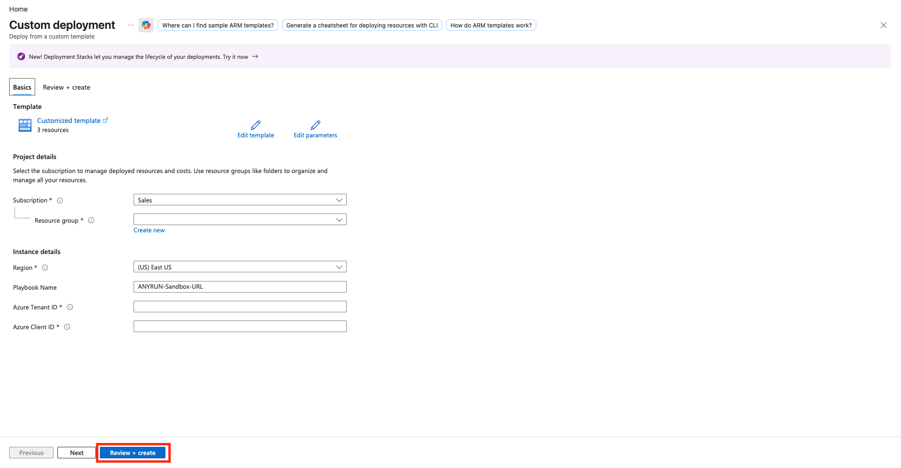
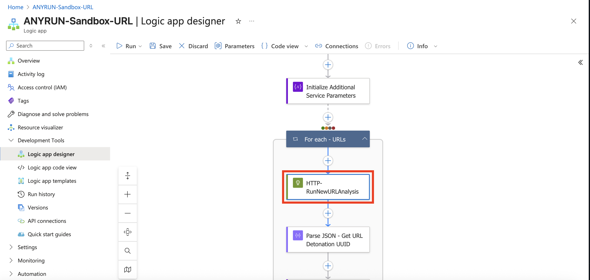
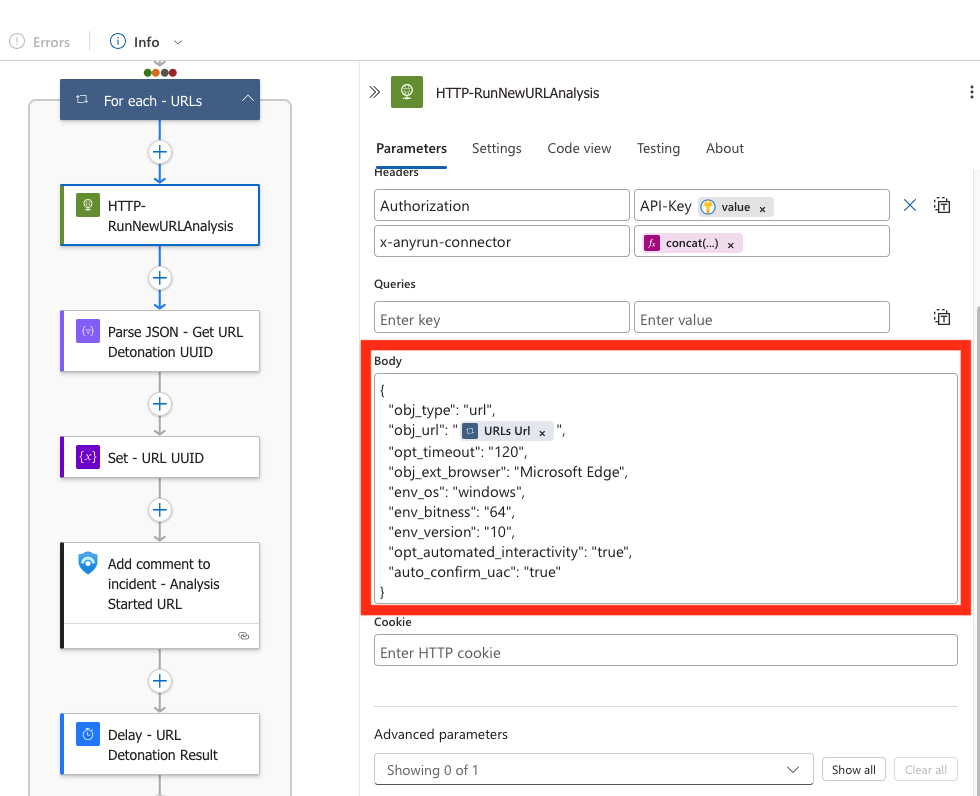
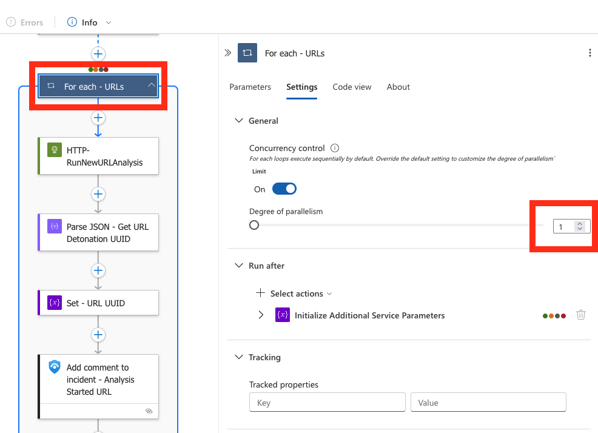

# ANY.RUN — Sandbox URL

## Summary

When a Microsoft Sentinel incident is created, this playbook:

- Extracts URL entities from the incident.
- Submits each URL for analysis in ANY.RUN Sandbox using the ANY.RUN API.
- Adds a comment to the incident with the analysis verdict, threat score, malware tags, IOC table, and a link to the analysis session.

## Prerequisites

Shared prerequisites (Key Vault secret `ANYRUN-APIKey`, App Registration, API permissions, and role assignments) are described in the [solution README](../../README.md).

Additional requirements for this playbook:

- Microsoft Sentinel incidents must contain URL entities.
- The playbook uses a Key Vault connection to retrieve the ANY.RUN API key. The secret must be named `ANYRUN-APIKey`.

## Deployment

Click below to deploy Azure Logic App with **Flex Consumption plan**

Enter the parameters required for deploying the Logic App and click **Review + create**.

Description of the required parameters:

| Parameter | Description |
|-----------|-------------|
| PlaybookName | Logic App name (default `ANYRUN-Sandbox-URL`). |
| Azure Tenant ID | Tenant ID for authentication in connections. |
| Azure Client ID | Client ID of the App Registration created for the solution. |

## Post-deployment

### Authorize API connections

After deployment, open the Logic App and authorize the API connections created by the template:

- **Microsoft Sentinel**
- **Key Vault**

Edit each connection, sign in with an account that has the required permissions, and save.

## Playbook steps

1. The playbook is triggered when a Microsoft Sentinel incident is created.
2. It retrieves URL entities from the incident.
3. It obtains the ANY.RUN API key from Key Vault.
4. For each URL it sends an HTTP request to the ANY.RUN API to start analysis.
5. It monitors the analysis until completion, then retrieves the report and IOCs.
6. It adds a comment to the incident containing the verdict, threat score, tags, IOC table, and a link to the analysis session.
7. Detected IOCs are uploaded to the Microsoft Sentinel Threat Intelligence portal.

The URL analysis parameters are defined in the HTTP action that starts the analysis. You can adjust them (timeout, browser, OS, interactivity, etc.) in the Logic App designer or code view. See the [ANY.RUN API documentation](https://any.run/api-documentation/) for the full list of parameters.

## Logic App configuration (Optional)

### ANY.RUN Sandbox analysis parameters

ANY.RUN is an interactive online malware analysis service for dynamic and static research of most types of threats using a customizable VM environment. We offer a connector for Microsoft Sentinel, which you can independently adapt to your infrastructure and needs in just a few clicks. You can easily change the parameters used for analyzing the required URL.

> Note:  
> You can learn more about the capabilities of ANY.RUN Sandbox by reviewing our [API documentation](https://any.run/api-documentation/).

The main setup and customization of the Logic App is available through the graphical editor (**Development tools** > **Logic app designer**) or the code editor (**Development tools** > **Logic app code view**).

The URL analysis parameters in ANY.RUN Sandbox are defined in the **HTTP-RunNewURLAnalysis** action.

Analysis options are specified in the HTTP request body.

Description of the default parameters:

| Parameter Name | Description |
| --- | --- |
| obj_type | Specifies the type of the new task (the value "url" is required for this workflow). |
| opt_timeout | Defines the timeout option for the analysis. |
| obj_ext_browser | Indicates the browser name to use. |
| env_os | Specifies the operating system. |
| env_bitness | Defines the bitness of the operating system. |
| env_version | Sets the version of the operating system. |
| opt_automated_interactivity | Controls the automated interactivity (ML) option (changing this is not recommended). |
| auto_confirm_uac | Enables automatic confirmation of Windows UAC requests (changing this is not recommended). |

> Note:  
> You can add more parameters for analysis. To see the full list of available parameters and their values, visit our [API documentation](https://any.run/api-documentation/).

###### Simultaneous Analysis of Objects in ANY.RUN Sandbox

ANY.RUN Sandbox allows users to perform multiple analyses simultaneously (availability and capability depend on your pricing plan). By default, if a Microsoft Sentinel incident contains multiple URLs, each analysis will run sequentially (a new URL analysis won't start until the previous one is finished).

To increase the speed of incident enrichment, you can analyze objects simultaneously. To do this, go to `For each - URL` loop > `Settings` and increase the `Degree of parallelism` value. Note that you should set a value that does not exceed the number of parallel analyses available at your pricing plan.

> Note:  
> To upgrade your pricing plan capabilities, [contact us](https://app.any.run/contact-us/).
