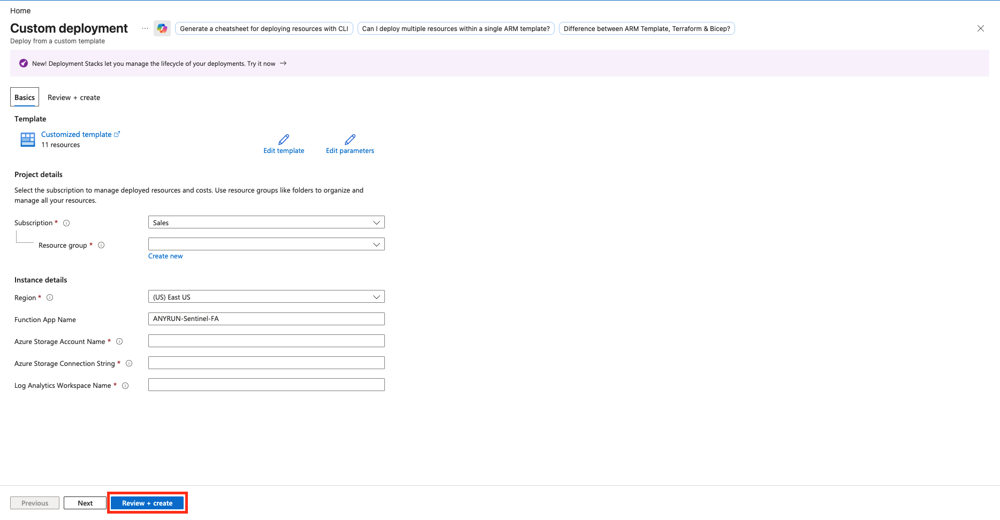

# ANY.RUN — Sentinel Function App

## Summary

This template deploys the Azure Function App `ANYRUN-Sentinel-FA` (Python, Flex Consumption plan).

The Function App is used by the file analysis playbooks (`Sandbox-File-Windows`, `Sandbox-File-Ubuntu`, `Sandbox-File-Debian`, and `Sandbox-File-Defender`) to submit files to ANY.RUN Sandbox and retrieve analysis results.

It is not required for the URL-only playbook.

## Prerequisites

Shared prerequisites (Key Vault secret `ANYRUN-APIKey`, App Registration, API permissions, role assignments, and Storage Account) are described in the [solution README](../../README.md).

Additional requirements for this Function App:

- An existing Azure Storage Account (the template also creates one if needed, but the connection string must be provided).
- An existing Log Analytics workspace.
- The Function App package (`Sentinel-FA.zip`) is deployed automatically from the repository.

## Deployment

- Click below to deploy Azure Function App with **Flex Consumption plan**

- Enter the parameters required for deploying the Function App and click **Review + create**.

- Description of the required parameters:

| Parameter | Description |
|-----------|-------------|
| FunctionAppName | Name of the Function App. |
| AzureStorageAccountName | Azure Blob Storage Account name. |
| AzureStorageConnectionString | Azure Blob Storage connection string. |
| LogAnalyticsWorkspaceName | Log Analytics workspace name. |

After deployment, note the Function App name. You will need it when deploying the file analysis playbooks that call this Function App.
