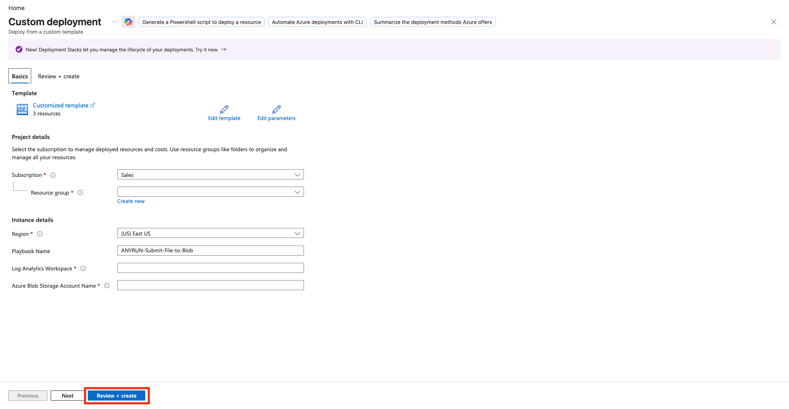

# ANY.RUN — Submit File to Blob

## Summary

> **Note:** This is a **child** Logic App. It is required **only** if you need to analyze files **and** you do **not** have Microsoft Defender for Endpoint (MDE).  
> If you have MDE, use the [Sandbox-File-Defender](../Sandbox-File-Defender/README.md) playbook instead. It collects files directly via MDE Live Response and does not require this child playbook.

This playbook is invoked by the parent file analysis playbooks (`Sandbox-File-Windows`, `Sandbox-File-Ubuntu`, `Sandbox-File-Debian`). It uploads a file from an endpoint to Azure Blob Storage so the parent can submit it to ANY.RUN Sandbox.

It is not triggered by Microsoft Sentinel incidents directly.

## Prerequisites

Shared prerequisites (Key Vault secret `ANYRUN-APIKey`, App Registration, API permissions, role assignments, and Storage Account) are described in the [solution README](../../README.md).

Additional requirements for this playbook:

- An existing Azure Storage Account and container for temporary file storage.
- An existing Log Analytics workspace.
- The Function App `ANYRUN-Sentinel-FA` must be deployed if you plan to analyze the uploaded files.
- This playbook must be deployed **before** the parent file playbooks (`Sandbox-File-Windows`, `Sandbox-File-Ubuntu`, `Sandbox-File-Debian`). Note its name — you will enter it as the Child Logic App Name parameter in the parent templates.

## Deployment

Click below to deploy Child Azure Logic App with **Flex Consumption plan**

Enter the parameters required for deploying the Logic App and click **Review + create**.

Description of the required parameters:

| Parameter | Description |
|-----------|-------------|
| PlaybookName | Logic App name (default `ANYRUN-Submit-File-to-Blob`). |
| Log Analytics Workspace | Log Analytics workspace name. |
| Azure Blob Storage Account Name | Storage account used to store files before they are submitted to ANY.RUN. |

## Post-deployment

### Authorize API connections

After deployment, open the Logic App and authorize the API connections created by the template:

- **Azure Monitor Logs**
- **Azure Blob Storage**

Edit each connection, sign in, and save.

## Playbook steps

1. The playbook is triggered by an HTTP request from a parent file analysis playbook.
2. It receives file information (path, machine, etc.).
3. It uploads the file from the endpoint to the specified Azure Blob Storage container.
4. It returns the blob location (or an error) to the parent playbook so the parent can submit the file to ANY.RUN Sandbox via the Function App.

This playbook does not analyze files itself and does not write comments to incidents. Those actions are performed by the parent playbooks.
