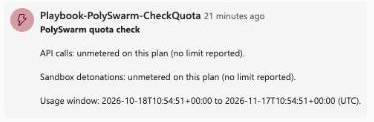

# PolySwarm-CheckQuota

Reads PolySwarm account features and remaining API and sandbox uses
(`GET /v3/public/accounts`) and always comments on the incident with how much API and
sandbox quota is used, the limit, how much remains and the percent remaining. A clearly
marked warning is added when either is below a configured threshold. Matters because
sandbox detonations are metered: you see the usage and are warned before a quota is
exhausted rather than after a submission fails.

File: `Playbooks/PolySwarm-CheckQuota/azuredeploy.json`, Microsoft Sentinel
incident-triggered.

## Summary

Reads the PolySwarm API key from Key Vault, calls `GET /v3/public/accounts`, and posts a
comment on the triggering incident every run. For daily API calls it reports used, limit,
remaining and percent remaining (from `daily_api_limit` and `daily_api_remaining`). For
sandbox detonations it reports the same for each metered sandbox feature (from
`base_uses` and `remaining_uses`). It also shows the account's current usage window
(`window_start` to `window_end`). If either quota is at or below its percentage threshold,
the comment adds a bold WARNING line.

The account response has no "used" field, so used is calculated as limit minus remaining.
The response also has no separate reset time; the usage window dates are shown as returned.

Unmetered plans: if the limit is missing, zero, or remaining is -1, the API line says
"unmetered on this plan (no limit reported)" and no used figure, percentage or warning is
produced. Sandbox is handled separately: if no sandbox feature has a positive `base_uses`
it reports sandbox as unmetered, and never divides by a missing or zero limit.

Revision 2: HTTP 204 with an empty body from the account call is reported as no account record
and is never parsed.

## Prerequisites

- A Microsoft Sentinel workspace, and permission to deploy Logic Apps and assign RBAC
  roles.
- A PolySwarm API key stored as a secret in an Azure Key Vault.

## Parameters

| Parameter | Notes |
| --- | --- |
| `PlaybookName` | Defaults to `PolySwarm-CheckQuota`. |
| `KeyVaultName` | No default; required. |
| `KeyVaultSecretName` | Default `PolySwarmApiKey`. |
| `PolySwarmApiBaseUrl` | Default `https://api.polyswarm.network/v3`. |
| `ApiQuotaWarningThresholdPercent` | Default `20`. Warn when remaining API quota falls below this percentage. |
| `SandboxQuotaWarningThresholdPercent` | Default `20`. Warn when remaining sandbox quota falls below this percentage. |
| `SandboxFeatureTagFilter` | Default `sandbox`. The account-features tag this playbook reads to find the sandbox quota entry. |
| `SolutionVersion` | Default `3.0.0`. The solution version sent in the User-Agent header on every PolySwarm call. Leave it as it is. |

## Post-deployment steps

1. Grant this playbook's managed identity **Key Vault Secrets User** on the Key Vault
   named in `KeyVaultName`.
2. Assign the **Microsoft Sentinel Responder** role on the resource group (or
   workspace) to the same managed identity.
3. Authorize the Microsoft Sentinel and Key Vault API connections if they show as
   unauthorized.
4. Attach the playbook to an automation rule triggered on incident creation. This
   playbook is Sentinel incident-triggered, not on a recurrence schedule; to check
   quota on a regular cadence independent of real incidents, attach it to an
   automation rule that runs against a scheduled synthetic incident, or trigger it
   manually.

## What the comment looks like

On an unmetered account (the lab account, which reports a daily limit of 0 and no metered
sandbox feature) the comment reads:

```
PolySwarm quota check
API calls: unmetered on this plan (no limit reported).
Sandbox detonations: unmetered on this plan (no limit reported).
Usage window: 2026-10-18T10:54:51+00:00 to 2026-11-17T10:54:51+00:00 (UTC).
```

On a metered account each line carries the figures, for example:

```
API calls: 360 used of 1000, 640 remaining (64% remaining).
Sandbox detonations: sandbox_request: 5 used of 50, 45 remaining (90% remaining).
```

The comment as it appears on an incident:



When below threshold, a line such as `WARNING: daily API quota is low (150 of 1000 calls
remaining).` is appended. The metered and low-quota wording is covered by unit tests
against recorded response shapes; it has not yet been seen on a live metered account,
because the account used for testing has no quota limit.

## Troubleshooting

See `README.md`, "Troubleshooting", for symptoms shared across every playbook.
