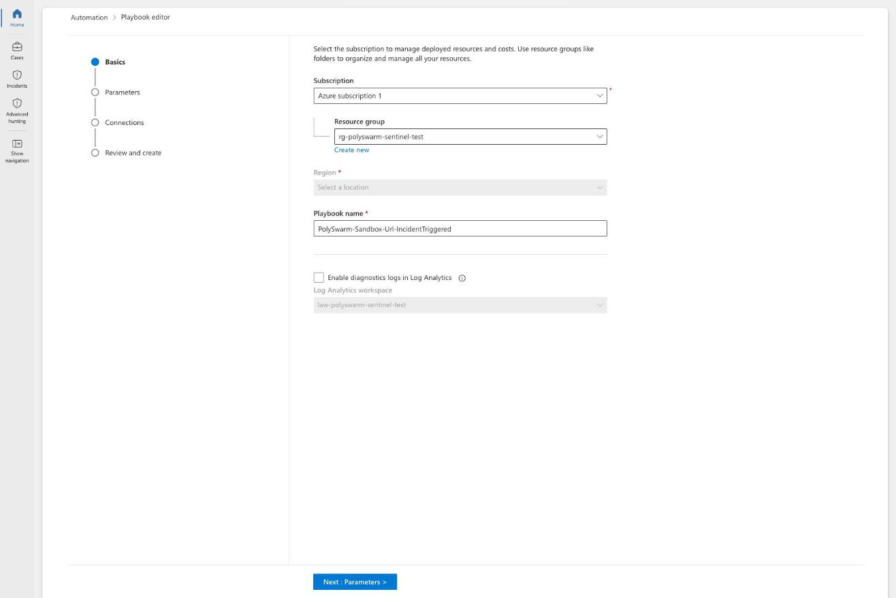
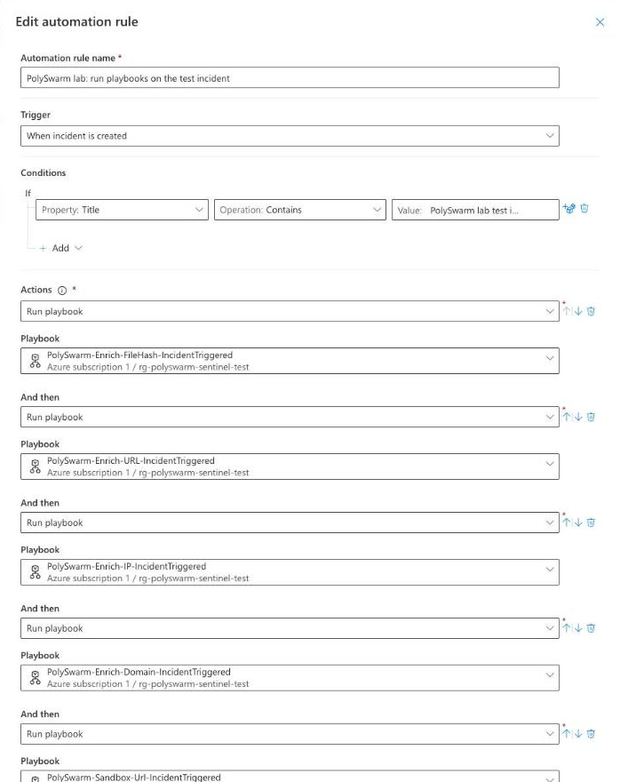
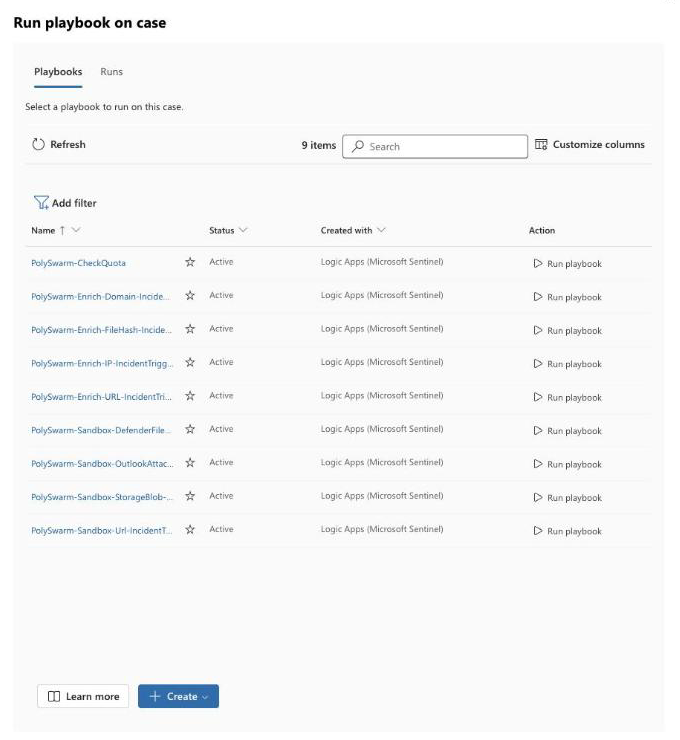
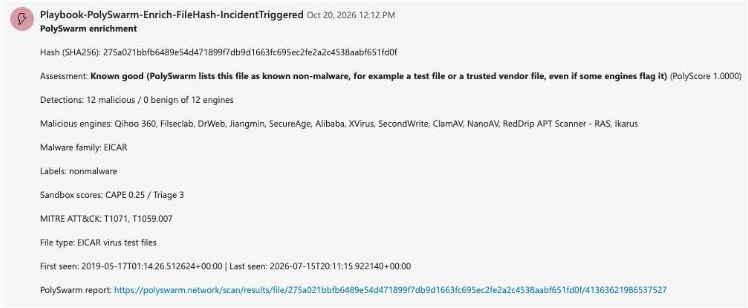
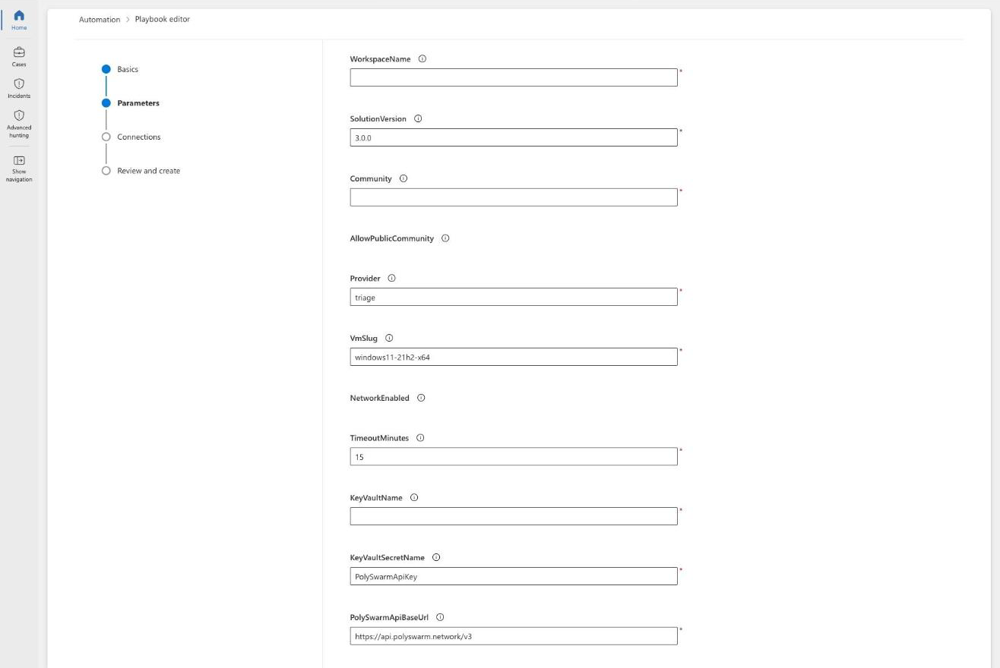
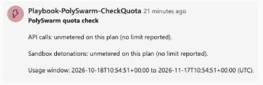

# PolySwarm for Microsoft Sentinel

PolySwarm's solution for the Microsoft Sentinel Content Hub. It brings multi-engine
malware verdicts, sandbox detonation and threat intelligence from PolySwarm into
Microsoft Sentinel, so an analyst can enrich, detonate and hunt against PolySwarm data
without hand-building Logic Apps against the PolySwarm API.

## Status

Version 3.0.0. Both data connectors, the analytics rules, the workbook and every
playbook except two have been installed and run in a live Microsoft Sentinel
workspace.

Two playbooks ship as **preview**: the Defender for Endpoint file detonation playbook
and the Outlook attachment detonation playbook. Both deploy cleanly and pass every
local check, but they have not yet been run against a live Defender for Endpoint
tenant or Exchange Online mailbox. If you try either one, please tell us how it went
at customersuccess@polyswarm.io.

## What the solution does

- **Enrichment.** Incident and entity-triggered playbooks look up a file hash, URL, IP
  address or domain against PolySwarm and post the verdict, PolyScore, the names of the
  engines that agreed, malware family and (where available) sandbox and MITRE ATT&CK
  detail as a comment on the incident.
- **Threat intelligence.** Two data connectors bring PolySwarm indicators into
  Microsoft Sentinel's native `ThreatIntelIndicators` table: one from your own
  PolySwarm hunting results, one from the PolySwarm curated feed. Because the
  indicators are native, Microsoft's threat intelligence matching rules can use them
  alongside the analytics rules this solution ships. Use the "TI Map" rules from
  Microsoft's Threat Intelligence solution that read `ThreatIntelIndicators`; older
  rules that read the legacy `ThreatIntelligenceIndicator` table do not see PolySwarm
  indicators. With the curated feed connected (about 500,000 indicators a day), shorten
  those rules' lookback to a day or two, since a 14-day lookback over that volume can
  run out of query memory and return nothing.
- **Sandbox detonation.** An analyst can submit a URL, an email attachment, a file in
  Azure Storage, or a file retrieved directly from an endpoint through Microsoft
  Defender for Endpoint, to the PolySwarm sandbox, and get a score-derived verdict,
  malware family, MITRE ATT&CK techniques and a best-effort report link back on the
  incident. Each detonating playbook writes its own result to a dedicated table, so an
  analytics rule can turn a malicious detonation into an incident.
- **Hunting.** Hunting queries join PolySwarm indicators against your own log tables.
  Both connectors deliver file-hash indicators, so alerts are on known-malicious files.
  The URL, IP address and domain hunting queries are ready for network indicators but
  return nothing from the shipped connectors.
- **Status.** A small PolySwarm status workbook shows what has arrived from each
  connector and each rule. It reads only tables in your workspace, never calls
  PolySwarm and needs no credential. A tile that says nothing has arrived yet is normal
  on a new install.

## Coverage by indicator type

- Answered: MD5, SHA-1, SHA-256, URL, domain and IP address.
- Not supported: email addresses. PolySwarm has no endpoint that answers them.

File hashes are scored from the PolyScore. URLs, domains and IP addresses are judged
from detection counts, because the URL PolyScore is a constant. A result
with no engine coverage is reported as unknown, never as benign, and an
artifact PolySwarm has no record of is a normal "not found". Domains and
IP addresses answer as a bare host through the URL lookup.

## Components

| Component | What it is |
| --- | --- |
| Enrichment playbooks | Incident and entity-triggered playbooks for file hash, URL, IP address and domain. |
| Sandbox playbooks | Detonate a URL, an Outlook attachment (preview), or an Azure Storage blob, from a Microsoft Sentinel incident. |
| Defender for Endpoint file detonation playbook (preview) | Retrieves a file from an onboarded device by SHA-256 and detonates it, with both incident- and entity-triggered variants. |
| Check quota playbook | Reads remaining PolySwarm API and sandbox usage and comments on the incident when a configured warning threshold is crossed. |
| Hunting data connector | Codeless Connector Framework (CCF) connector that polls your PolySwarm live hunt results into the native `ThreatIntelIndicators` table. |
| Curated feed data connector | CCF connector that polls the PolySwarm curated indicator feed into the native `ThreatIntelIndicators` table, for accounts without hunts configured. |
| Sandbox results infrastructure | Shared Data Collection Endpoint, table and Data Collection Rule that every sandbox-detonating playbook writes one row to, via the Logs Ingestion API, once a detonation reaches a terminal state. Not a data connector the customer configures with an API key; see "Sandbox results: how the data actually gets there" below. |
| Status workbook | `Workbooks/PolySwarmStatus.json`. Connector and rule status read from your own workspace tables, with an explicit message on every tile that has nothing to show yet. |
| Analytics rules | Three rules that correlate PolySwarm indicators with your own log sources and raise incidents from malicious sandbox detonations. |
| Hunting queries | Four saved queries joining PolySwarm indicators against your log tables (hash, IP, URL, domain). |

## After you install

Installing the solution does not turn anything on. Everything below ships switched off
or unconnected, and each item has one action that turns it on.

1. **Analytics rules (three templates).** PolySwarm high-confidence hunt hit,
   PolySwarm malicious file observed and PolySwarm sandbox detonation malicious are
   rule templates, not active rules. Turn one on by opening Analytics, then Rule
   templates, selecting it and choosing Create rule.
2. **Data connectors (hunting and curated feed).** Neither collects anything until it
   is configured. Open the connector under Data connectors, enter the credentials and
   settings, and choose Connect.
3. **Incident-triggered playbooks (every enrichment, sandbox and check quota playbook,
   and the Defender for Endpoint file playbook).** None runs until an automation rule
   runs it. Create an automation rule that runs the playbook when an incident is
   created. Grant the playbook's managed identity its roles first
   ([Permissions](#permissions)).
4. **Entity-triggered playbooks.** No automation rule applies to these.
   Entity-triggered playbooks run only when someone starts them on one entity. As of
   October 2026 the Microsoft Defender portal has no Run playbook action on an entity, so
   in the Defender portal run the incident-triggered version on the whole incident
   instead (select the incident in the Incidents list, then Run Playbook). Workspaces not
   yet moved to the Defender portal can still run entity playbooks from an entity on the
   incident page in the Azure portal, and any workspace can start one through the
   Microsoft Sentinel API (Entities, Run Playbook).
5. **Sandbox results table.** `PolySwarmSandbox_CL` is created for you the first time
   you create a sandbox playbook from its template (URL, Outlook attachment, Storage
   blob or Defender file). Each of those templates also creates the `polyswarm-dce`
   Data Collection Endpoint and the `polyswarm-dcr-sandbox-results` Data Collection
   Rule, with fixed names, so creating several sandbox playbooks is safe. Enter your
   workspace name when you create the playbook, in the same resource group as the
   workspace. The sandbox detonation rule has nothing to read until a playbook has
   written a row. `Data Connectors/PolySwarmSandboxResults/azuredeploy.json` still
   works as an optional standalone deployment of the same three resources.
6. **Hunting queries (four).** These are saved queries and run only when an analyst
   runs them from Hunting. Only the file hash query has PolySwarm data to match today;
   the URL, IP address and domain queries are ready for network indicators.

The PolySwarm status workbook is the place to see which of these has started producing
data. Open it from Workbooks, then Templates.

## How much data the curated feed adds

The PolySwarm Curated Feed is large. In our test workspace (October 2026) the Trust
Group 14-day feed added about **500,000 indicators a day**, roughly **0.5 GB a day** in
the ThreatIntelIndicators table (about 170,000 files a day, each as an MD5, SHA-1 and
SHA-256 indicator). Microsoft Sentinel charges for data it ingests, so check
[Microsoft Sentinel pricing](https://azure.microsoft.com/pricing/details/microsoft-sentinel/)
for that volume before you connect the feed.

The PolySwarm Hunting connector is much smaller: it only brings in files that match
your own hunts.

If the feed volume does not suit you, tell PolySwarm support. We will use that
feedback to decide whether to add a smaller option.

## Required network egress

If you restrict outbound traffic from Azure, allow these hosts on port 443:

- `api.polyswarm.network`, for every lookup, hunt result, feed read and sandbox call.
- `ps-storage-prodv2-artifact-index.s3.us-east-2.amazonaws.com`, an Amazon S3 host in
  the us-east-2 region, which receives the file or URL bytes during a sandbox upload.
  Only the sandbox playbooks use it. PolySwarm returns the full upload address
  (host and a signed query string) when a detonation is created; allow the host only.

## Navigating Microsoft Sentinel

Microsoft Sentinel leaves the Azure portal after 31 March 2027 and becomes available
only from the Microsoft Defender portal (`security.microsoft.com`). This documentation
gives the Defender portal path first for anything Sentinel-specific: Content Hub, data
connectors, analytics rules, automation rules, and incidents. A few steps genuinely
live in the Azure portal regardless of which portal you use for Sentinel itself,
because they are Azure resource operations rather than a Sentinel screen: deploying a
Logic App, managing an Azure Key Vault, and assigning
Azure RBAC roles (Access control (IAM)). Those steps say "Azure portal" explicitly
wherever they come up.

## Prerequisites

- A Microsoft Sentinel workspace, in a resource group you can deploy Logic Apps,
  connectors and role assignments into.
- A PolySwarm API key. Generate one from your PolySwarm account. Keys are never
  committed to this repository; every deployed playbook reads its key from Azure Key
  Vault through its managed identity, not from a plain deployment parameter. The two
  data connectors take their credentials in their own connector pages instead. See
  "Key Vault setup" below.
- Your PolySwarm account must carry the entitlement for each capability you deploy:
  - **Sandbox detonation**, for the sandbox playbooks, the Defender for Endpoint file
    detonation playbook, and the shared sandbox results infrastructure.
  - **Private community**, for detonating in a community that is not visible to other
    PolySwarm users. See "Public vs private community" below; this is the default for
    every sandbox playbook in this solution.
  - **Live hunting**, for the hunting data connector, which turns your own PolySwarm
    hunt results into native Sentinel indicators.
  - **Curated feed / TAXII entitlement** (`taxii`, plus the specific feed's own
    entitlement, for example `taxii_trustgroup`), for the curated feed data connector.
  Contact your PolySwarm representative or customersuccess@polyswarm.io to confirm
  which entitlements are on your account.
- For the Defender for Endpoint file detonation playbook only: Microsoft Defender for
  Endpoint Plan 2, with **Live response** and **Live response for servers** enabled in
  the Microsoft Defender portal (`security.microsoft.com`) under Settings > Endpoints >
  Advanced features, and at least one onboarded device.

## Deployment order

1. Confirm the prerequisites above, including which entitlements your PolySwarm
   account carries.
2. Set up Azure Key Vault and store your PolySwarm API key there (see below).
3. Sandbox-detonating playbooks (URL, Outlook attachment, Storage blob, Defender file)
   create the shared sandbox results infrastructure themselves, so there is no separate
   step. You only enter your workspace name, which must be in the same resource group
   as the playbook. Optionally, deploy
   `Data Connectors/PolySwarmSandboxResults/azuredeploy.json` ahead of time to create
   the same resources.
4. Deploy the data connectors, enrichment playbooks, sandbox playbooks, check quota
   playbook, analytics rules and hunting queries you need; each deploys
   independently once its own prerequisites (above) are met.
5. Grant every deployed playbook's managed identity the roles and API
   permissions it needs. See [Permissions](#permissions) for the complete list and
   [Grant managed identity role assignments](#grant-managed-identity-role-assignments)
   for the role assignment steps.
6. Configure each data connector (your API key, the community for the hunting
   connector, the feed for the curated feed connector) and confirm it shows connected.
7. Enable the analytics rules you want active.
8. Attach the incident-triggered playbooks to automation rules. Entity-triggered
   playbooks are started by hand (see "After you install" above).
9. For the Defender for Endpoint file detonation playbook, confirm the workspace is
   onboarded to Microsoft Defender XDR as the primary workspace, run
   `Playbooks/PolySwarm-Sandbox-DefenderFile/grant-defender-permissions.sh`, and
   confirm at least one device is onboarded with live response enabled.
10. Test. See [Test the deployment](#test-the-deployment) for the smoke test steps.

New to Microsoft Sentinel? Start with [Getting started](#getting-started), a
plain-language walkthrough with screenshots. Full step by step instructions for
administrators are in the [Deployment reference](#deployment-reference).

## Key Vault setup

Every playbook in this solution reads the PolySwarm API key from Azure Key Vault
through its own managed identity, using a Key Vault API connection deployed alongside
it. None of them accept the key as a plain deployment parameter.

1. Create an Azure Key Vault in the same tenant as your Sentinel workspace, or use an
   existing one your security team already manages. The vault must have
   `enabledForTemplateDeployment` set to `true`, or its connection resource deploys
   against RBAC only, which is the default and is sufficient here.
2. Store your PolySwarm API key as a secret, for example named `PolySwarmApiKey`.
3. When you deploy a playbook, supply the vault's name as its `KeyVaultName`
   parameter, and, if you used a different secret name, the secret's name as
   `KeyVaultSecretName`. The deployment creates a Key Vault API connection for that
   playbook.
4. After deployment, grant the playbook's managed identity the **Key Vault Secrets
   User** role, scoped to the Key Vault (or to that one secret, if your Key Vault uses
   access policies with per-secret scoping). This is a read-only role: it lets the
   identity retrieve secret values but not manage the vault or other secrets.
5. Authorize the Key Vault API connection in the Azure portal if it shows as
   unauthorized. This is a Logic Apps connection resource, an Azure resource rather
   than a Sentinel-specific screen, so it is managed from the Azure portal even after
   Microsoft Sentinel itself moves fully to the Defender portal.

Every enrichment playbook (file hash, URL, IP, domain, both incident- and
entity-triggered variants), every sandbox playbook, the Defender for Endpoint file
detonation playbook, and the check quota playbook are built this way.

The curated feed data connector reads its credentials differently: the PolySwarm
TAXII server authenticates with HTTP Basic auth (your PolySwarm account number as the
username, your Team API key as the password), not the `Authorization: <key>` header
scheme every other PolySwarm call in this solution uses. You enter both values
directly in the connector's own configuration pane; they are not read from Key Vault.
The hunting connector works the same way: you enter its API key in the connector's
configuration pane.

## Sandbox results: how the data actually gets there

An earlier design polled PolySwarm's sandbox task list API for a `PolySwarmSandbox_CL`
table. Measurement showed that API returns no verdict, malware family, ATT&CK
techniques or completion time for any task, so a poller could not populate the columns
that make the table useful. The table is instead filled directly by whichever
playbook ran the detonation, right after it polls the task to completion, since that
playbook already holds the full result.

Every sandbox-detonating playbook template (URL, Outlook attachment, Storage blob,
Defender file) creates the shared infrastructure itself, idempotently, with fixed
names: a Data Collection Endpoint (`polyswarm-dce`), the `PolySwarmSandbox_CL` table
(17 columns: `TimeGenerated, TaskId, ArtifactType, Sha256, Url, FileName, Source,
Provider, Community, Verdict, Score, Family, Techniques, ReportUrl, CreatedAt,
CompletedAt, IncidentArmId`), and a Data Collection Rule
(`polyswarm-dcr-sandbox-results`, stream `Custom-PolySwarmSandboxResults`). Each
template takes a required `WorkspaceName` parameter (the workspace must be in the same
resource group) and works out the endpoint address, rule id and stream on its own.
`Data Connectors/PolySwarmSandboxResults/azuredeploy.json` remains as an optional
standalone way to create the same three resources ahead of time.

Each of those playbooks then:

- Posts one row via the Logs Ingestion API
  (`{endpoint}/dataCollectionRules/{immutableId}/streams/Custom-PolySwarmSandboxResults?api-version=2023-01-01`,
  managed identity auth, audience `https://monitor.azure.com`) for every detonation
  attempt, including timeouts, so the table reflects every submission, not only the
  successful ones.
- Needs the **Monitoring Metrics Publisher** role on the Data Collection Rule
  (`polyswarm-dcr-sandbox-results`) to write to it. Each playbook template can create
  this role assignment for itself automatically at deployment (the
  `create_role_assignment` parameter, default `true`), a pattern also used by other
  published Content Hub solutions with a similar sandbox-and-Logs-Ingestion design; set
  it to `false` and grant the role manually if the deploying principal cannot grant
  RBAC roles.

`Source` records which playbook wrote a given row: `Url`, `OutlookAttachment`,
`StorageBlob` or `DefenderFile`.

## Sandbox verdict

Neither sandbox provider PolySwarm uses (CAPE, Triage) returns a maliciousness verdict
string. Both return a raw score on a 0 to 10 scale. Every sandbox-detonating playbook
derives a verdict from that score with the same rule:

- `KNOWN_GOOD` task status (PolySwarm's allowlist recognized the artifact and skipped
  detonation) becomes **known good**.
- No score at all (a timed-out or failed detonation) becomes **unknown**.
- A score of 7 or higher (`MaliciousScoreThreshold`, a playbook parameter) becomes
  **malicious**.
- A score of 4 or higher but below the malicious threshold
  (`SuspiciousScoreThreshold`) becomes **suspicious**.
- Anything else becomes **benign**.

This is a score-threshold approximation the playbooks apply, not a categorical
verdict either sandbox provider returns. State this plainly in any customer-facing
description of the sandbox playbooks.

The report link included in the comment
(`https://polyswarm.network/scan/results/file/{sha256}/{id}`) is built from the same
pattern the PolySwarm hash-lookup uses. It is confirmed to work for artifacts that
also appear in the multi-engine scan index, but a pure-sandbox-only submission's hash
returned HTTP 404 from that lookup in testing, so whether the link resolves for a
sandbox-only result is unconfirmed. Treat it as best effort until verified against a
live portal check.

## Public vs private community

A PolySwarm community is a boundary around who can see a submission and its result.
The **public community** is visible to other PolySwarm users; a **private community**
is visible only to your organization.

Every sandbox playbook in this solution defaults to your private community and
refuses to submit to the public community unless `AllowPublicCommunity` is explicitly
set to `true`. This is because a file or URL submitted to a public community becomes
visible to everyone else using that community, and Sentinel incidents routinely
contain sensitive attachments and internal URLs that should never leave the
organization by default. Enrichment lookups (which only query artifacts PolySwarm has
already seen; they do not submit anything) are not affected by this default.

Isolation was confirmed live: an account is only ever shown a task belonging to a
community it is entitled to, regardless of what community value is passed on a read.
Passing a different, valid community you are also entitled to does not leak or hide
another community's data; the community parameter on a lookup is a correctness input
(which task you mean), not by itself the security boundary. The boundary is account
entitlement.

## Analytics rules and hunting queries

Three analytics rules ship with the solution, all Scheduled rules:

- **PolySwarm malicious file observed**, severity High. Joins active PolySwarm
  file-hash indicators against your device and security event tables (file and
  process events, security events, common security log) on SHA-256, SHA-1 or MD5, and raises an
  incident carrying the file hash, host and account. Depends on either the hunting or
  the curated feed data connector, both of which write to the native
  `ThreatIntelIndicators` table.
- **PolySwarm high-confidence hunt hit**, severity Medium. Raises an incident on any
  PolySwarm Hunting indicator with a confidence of 90 or higher created in the last
  hour, grouped by malware family. Only indicators that carry a hunt rule name qualify,
  so curated feed indicators never match. The rule lists both connectors as data
  connectors, but only the hunting connector produces matching rows. The rule's own severity and MITRE tactic are fixed at rule level, as
  Microsoft Sentinel requires; the malware family and hunt rule name that produced the
  indicator are carried on the incident as columns rather than changing the rule's
  tactic dynamically.
- **PolySwarm sandbox detonation malicious**, severity High. Raises an incident from
  any `PolySwarmSandbox_CL` row with a malicious verdict, covering file and URL
  detonations from every sandbox-detonating playbook. The sandbox playbooks write that
  table, and the rule declares no data connector because no connector writes it.
  This is how a PolySwarm sandbox verdict becomes an incident in the unified Defender
  portal, since the
  playbooks that submit detonations only post an incident comment and never create an
  incident directly.

Four hunting queries join PolySwarm indicators against your own log tables for hash,
IP address, URL and domain, for an analyst to run interactively. Both connectors
deliver file-hash indicators, so the file hash query is the one with PolySwarm data to
match; the URL, IP address and domain queries are ready for network indicators and
return nothing from the shipped connectors.

## User agent

Every call this solution makes to the PolySwarm API carries a `User-Agent` header in
the form `PolySwarm-Microsoft-Sentinel/3.0.0 (<component>)`, for example
`PolySwarm-Microsoft-Sentinel/3.0.0 (HuntingConnector)`. This exists so PolySwarm can
see which customers are running this solution and on which version, which matters for
support and for knowing when an older version is still in the field. It carries no
customer data: no incident content, no entity values, no tenant identifier, only the
solution's own name and version and the calling component's name.

## Troubleshooting

| Symptom | Likely cause |
| --- | --- |
| A playbook fails with a 403 posting a comment or reading incident entities | Its managed identity is missing the **Microsoft Sentinel Responder** role. See [Permissions](#permissions). |
| A playbook fails reading the PolySwarm API key | Its managed identity cannot read the secret: on a vault using Azure role-based access control it needs **Key Vault Secrets User**; on a vault using access policies it needs an access policy with the **Get** secret permission. Or the secret name does not match what the playbook expects. |
| A sandbox playbook fails writing to `PolySwarmSandbox_CL` | Its managed identity is missing **Monitoring Metrics Publisher** on the Data Collection Rule, or the `WorkspaceName` entered at deployment does not match the workspace in the playbook's resource group. |
| A data connector shows disconnected | The stored PolySwarm API key or, for the curated feed connector, account number/API key pair is invalid, or the account does not carry the entitlement that connector needs. |
| No PolySwarm result, HTTP 401 | The PolySwarm API key is invalid or missing. |
| No PolySwarm result, HTTP 204 with an empty body | PolySwarm has no record of the artifact. This is a normal outcome, not an error. |
| No PolySwarm result, HTTP 429 | The PolySwarm rate limit was reached. Playbooks and connectors retry with backoff; persistent 429s mean sustained traffic is exceeding one of these limits. Confirm your PolySwarm plan's published limit. |
| A sandbox submission fails immediately | Your account has exhausted its sandbox detonation quota, or the requested community does not exist for your account. The comment states which. |
| A sandbox detonation shows verdict "unknown" | The detonation timed out or failed before a score was produced. Check the report link and task id in the comment. |
| The Defender for Endpoint file detonation playbook cannot retrieve a file | The device is offline, or the managed identity is missing one of the required Defender for Endpoint API permissions. Confirm you ran `grant-defender-permissions.sh`, and see [Permissions](#permissions). |
| A playbook never runs | No automation rule is attached to it, or the rule's conditions exclude the incident. |
| A playbook does nothing | Open the playbook in the Azure portal and look at its **Runs history**. A failed Key Vault step almost always means the playbook has not been given permission to read the key yet. |
| A connector will not connect | Check that you pasted the whole API key, and that the Community is `public` or the short name of a private community, not its display name. |
| Connected, but no data after an hour | For PolySwarm Hunting, check that you have at least one live hunt on polyswarm.network. For the curated feed, check that your plan includes the feed you chose. |

## Getting started

This guide walks you through setting up PolySwarm in Microsoft Sentinel one step at a
time, with a picture of each screen. You do not need to know how Azure works to follow
it. Plan on about 30 minutes.

When you are done, Microsoft Sentinel will:

- bring in files that match your PolySwarm hunts,
- bring in the PolySwarm curated feed of known bad files, if your plan includes it,
- show what has arrived on a status page, and
- add PolySwarm's verdict to an incident when you ask it to.

If anything here does not match what you see, email customersuccess@polyswarm.io.

### What you need before you start

1. **A Microsoft Sentinel workspace**, and permission to change it. If you can open
   Microsoft Sentinel and see its settings, you probably have enough.
2. **Your PolySwarm API key.** Sign in at polyswarm.network, open your account
   settings, and copy the API key.
3. **Your PolySwarm account number**, only if you will connect the curated feed. It is
   on the same account settings page.
4. **An Azure Key Vault** you can add a secret to. A Key Vault is Azure's locked box for
   passwords and keys. If your company does not have one yet, ask whoever runs your
   Azure account to create one for you.

You will use two websites:

- the **Microsoft Defender portal**, at security.microsoft.com, for everything inside
  Microsoft Sentinel, and
- the **Azure portal**, at portal.azure.com, only for the Key Vault.

If the Defender portal says your account "needs to be added as an external user",
add your directory to the address, like this:
security.microsoft.com/?tid=yourcompany.onmicrosoft.com

### Step 1. Put your PolySwarm API key in the Key Vault

The playbooks read your key from the Key Vault, so it never sits in plain text anywhere.

1. In the Azure portal, search for **Key vaults** and open your vault.
2. On the left, choose **Objects**, then **Secrets**.
3. Choose **Generate/Import**.
4. For **Name**, type `PolySwarmApiKey`.
5. For **Secret value**, paste your PolySwarm API key.
6. Choose **Create**.

You should now see `PolySwarmApiKey` in the list, with the status **Enabled**. The key
itself is never shown.

### Step 2. Install PolySwarm from the Content hub

1. In the Defender portal, open **Microsoft Sentinel**, then **Content management**, then
   **Content hub**.
2. Search for **PolySwarm** and select it.
3. Choose **Install**. It takes a minute or two.

This adds the two data connectors, the status workbook, three analytics rules, four
hunting queries and the playbook templates to your workspace. Nothing runs yet.

### Step 3. Connect PolySwarm Hunting

A hunt is a YARA rule you set up on polyswarm.network. Every time a file anywhere on
PolySwarm matches one of your rules, this connector brings that file's hashes into
Microsoft Sentinel. If you have no live hunts yet, the connector has nothing to bring
in, and that is normal.

1. In Microsoft Sentinel, open **Configuration**, then **Data connectors**.
2. Type **PolySwarm** in the search box. You will see two connectors.

   <picture><source media="(prefers-color-scheme: dark)" srcset="Data%20Connectors/PolySwarmHunting_CCF/images/data-connectors-polyswarm-dark.png"></picture>

3. Select **PolySwarm Hunting**, then **Open connector page**.

   <picture><source media="(prefers-color-scheme: dark)" srcset="Data%20Connectors/PolySwarmHunting_CCF/images/hunting-side-pane-dark.png"></picture>

4. Paste your PolySwarm API key into **PolySwarm API Key**.
5. Leave **Community** as `public`, unless your hunts run in a private community. Then
   type its short name instead (lowercase, no spaces). PolySwarm support can tell you
   the short name.
6. Leave **Polling window** at 15 minutes.
7. Select **Connect**. It can take up to a minute, and the page does not show progress
   while it works.

   <picture><source media="(prefers-color-scheme: dark)" srcset="Data%20Connectors/PolySwarmHunting_CCF/images/hunting-page-connected-dark.png"></picture>

When it works, the button changes to **Disconnect** and the status turns **Connected**.
The key box looks empty again afterwards. That is normal: Azure never shows a saved key.

<picture><source media="(prefers-color-scheme: dark)" srcset="Data%20Connectors/PolySwarmHunting_CCF/images/hunting-what-to-expect-dark.png"></picture>

### Step 4. Connect the PolySwarm Curated Feed (if your plan includes it)

The curated feed is a large list of known bad files from PolySwarm, about 500,000
indicators a day (roughly 0.5 GB a day). Microsoft Sentinel charges for the data it
takes in, so check Microsoft Sentinel pricing before you connect it.

1. In **Data connectors**, select **PolySwarm Curated Feed**, then **Open connector
   page**.

   <picture><source media="(prefers-color-scheme: dark)" srcset="Data%20Connectors/PolySwarmFeed_CCF/images/feed-side-pane-dark.png"></picture>

2. Type your PolySwarm account number into **PolySwarm Account Number**.
3. Paste your API key into **PolySwarm API Key**.
4. Choose your feed in **Feed**. If you are not sure, choose **Trust Group 14-day**.
5. Leave **Polling window** at 60 minutes.
6. Select **Connect**.

<picture><source media="(prefers-color-scheme: dark)" srcset="Data%20Connectors/PolySwarmFeed_CCF/images/feed-page-connected-dark.png"></picture>

After you connect, the boxes look empty and the Feed box shows its hint text instead
of your choice. That is normal.

When both connectors are connected, both show a green bar in the list, as in the data connectors screenshot above.

### Step 5. Check the status page

The PolySwarm status workbook shows what has arrived from each connector. It only reads
your own workspace. It never calls PolySwarm.

1. In Microsoft Sentinel, open **Threat management**, then **Workbooks**, then the
   **Templates** tab.
2. Select **PolySwarm status**, then **View template**.

You will see one chart for each connector, when each last delivered something, and
tiles for sandbox results and alerts.

Give it an hour after connecting. A tile that says nothing has arrived yet is normal on
a new install; each one fills as its source starts producing data.

### Step 6. Turn on the analytics rules

The three PolySwarm analytics rules ship switched off, so they never surprise you with
alerts.

1. In Microsoft Sentinel, open **Configuration**, then **Analytics**, then the
   **Rule templates** tab.
2. Search for **PolySwarm**.
3. Select a rule, then **Create rule**, and go through the pages with the defaults.

What each rule does:

- **PolySwarm malicious file observed** raises an alert when a file PolySwarm knows is
  bad shows up in your device or security logs.
- **PolySwarm high-confidence hunt hit** raises an alert when one of your hunts matches
  a file PolySwarm is very sure about.
- **PolySwarm sandbox detonation malicious** raises an alert when a PolySwarm sandbox
  playbook finds a file or link is malicious.

When a rule fires, the alert becomes an incident. If your workspace is onboarded to the
Microsoft Defender portal, PolySwarm incidents appear there too.

### Step 7. Add PolySwarm's verdict to incidents

Playbooks are small automations that run on an incident. The simplest one to start with
is **PolySwarm-Enrich-FileHash-IncidentTriggered**: it looks up every file hash on an
incident and adds PolySwarm's verdict as a comment.

1. In the **Content hub**, open **PolySwarm**, then **Manage**.
2. Find **PolySwarm-Enrich-FileHash-IncidentTriggered**, select it, and choose
   **Configuration**. This takes you to the playbook template.
3. Choose **Create playbook**. On the first page, pick your resource group and region.
   Leave the playbook name as it is.

   

4. On the **Parameters** page, type the name of your Key Vault (the vault from step 1).
   Leave everything else as it is.
5. Go through the remaining pages and choose **Create**.
6. Give the new playbook permission to read the key and to comment on incidents. Your
   Azure administrator can follow
   [Grant managed identity role assignments](#grant-managed-identity-role-assignments)
   in the deployment reference below.

Then tell Microsoft Sentinel when to run it:

1. Open **Configuration**, then **Automation**, then **Create**, then **Automation rule**.
2. Under **Actions**, choose **Run playbook** and pick the PolySwarm playbook.
3. Save.

You can also run a playbook by hand on one incident: in the **Incidents** list, select
the incident (do not open it), choose **Run Playbook** in the pane on the right, and
choose **Run playbook** next to the PolySwarm playbook you want.

### Step 8. See it work

When the playbook runs, PolySwarm's answer appears on the incident. Open the incident,
select the **Activities** tab, and select the PolySwarm comment to read it in full. (The
short list of activities runs each comment together on one line; the full view keeps
its lines.)

The comment gives the verdict, how many scanning engines called the file malicious,
the malware family when known, and a link to the full PolySwarm report.

### Detonate a link in the PolySwarm sandbox

The sandbox playbook runs each link on an incident in a PolySwarm sandbox and reports
what happened. Create it the same way as the enrichment playbook.

1. In the **Content hub**, open **PolySwarm**, then **Manage**.
2. Find **PolySwarm-Sandbox-Url-IncidentTriggered**, select it, and choose
   **Configuration**, then **Playbook templates**, then **Create playbook**.
3. On the **Parameters** page, fill in three values:

   - **WorkspaceName**: the name of your Log Analytics workspace, which must be in the
     same resource group as the playbook.
   - **Community**: the short name of your private PolySwarm community. The playbook
     will not submit to the public community unless you also set
     **AllowPublicCommunity** to true.
   - **KeyVaultName**: the name of your Key Vault (the vault from step 1).

   

4. Go through the remaining pages and choose **Create**. The first deployment also
   creates the table the sandbox results are stored in, and the collection resources
   that feed it. You do not need to set those up yourself.

Then grant the roles and attach it to an incident, as in the steps above for the
enrichment playbook. Detonation is metered and takes minutes, so consider running it by
hand on an incident rather than on every one.

When it finishes, the incident gets a comment with the verdict and the sandbox score out
of 10, the sandbox provider and virtual machine, the malware family and MITRE ATT&CK
techniques when the sandbox finds them, the community, the task id, and a link to the
PolySwarm report. Each result is also written to the sandbox results table, which feeds
the sandbox detonation rule and the status workbook.

### Check your quota

The **PolySwarm-CheckQuota** playbook adds a comment to an incident showing how much of
your PolySwarm quota you have used. Create it from its template the same way, then run
it by hand on an incident.

A plan with no limits shows unmetered. On a metered plan the comment shows
used, limit and remaining for API calls and sandbox detonations, and a warning when
either runs low.

### Other playbooks

The solution includes more playbooks: lookups for links, IP addresses and domains, and
sandbox playbooks that run a link or a file in PolySwarm's sandbox and report what it
did. Each one has its own page in the Playbooks folder explaining what it needs.

Two playbooks are in **preview**: the Defender for Endpoint file playbook and the
Outlook attachment playbook. They work in our tests but have not yet been tried on a
live Defender for Endpoint tenant or Exchange Online mailbox. If you try one, please
tell us how it went at customersuccess@polyswarm.io.

If a step does not work, see [Troubleshooting](#troubleshooting).

## Deployment reference

Step by step deployment for administrators. The sections above cover prerequisites,
entitlements, the Key Vault setup and the network hosts to allow; [Permissions](#permissions)
lists every role and API permission named below.

Deploy only the components you have the PolySwarm entitlement for. Every playbook and
connector deploys independently, except that every sandbox-detonating playbook depends
on the shared sandbox results infrastructure, which its own template creates.

Which portal each step uses is described in "Navigating Microsoft Sentinel" above. The
Microsoft Defender portal (`security.microsoft.com`) is given first for anything
Sentinel-specific (Content Hub, data connectors, analytics, automation); the Azure
portal is named explicitly for the handful of steps that are Azure resource operations
rather than a Sentinel screen (deploying Logic Apps, Key Vault, and Azure RBAC role
assignments).

### Sandbox results infrastructure (created by the sandbox playbooks)

There is nothing to deploy separately. Every sandbox-detonating playbook template
(URL, Outlook attachment, Storage blob, Defender file) creates the shared
infrastructure itself when you deploy it, with fixed names:

- A Data Collection Endpoint, `polyswarm-dce`.
- The `PolySwarmSandbox_CL` table (17 columns) on your workspace.
- A Data Collection Rule, `polyswarm-dcr-sandbox-results`, with input stream
  `Custom-PolySwarmSandboxResults`.

Because the names are fixed and Azure resource deployment is idempotent, deploying
several sandbox playbooks, or redeploying one, is safe. Each template takes a
required `WorkspaceName` parameter: the Log Analytics workspace backing your Microsoft
Sentinel instance, which must be in the same resource group you deploy the playbook to.
The playbook finds the endpoint address, rule id and stream on its own, and grants its
own managed identity Monitoring Metrics Publisher on the rule when
`create_role_assignment` is true (the default).

If you would rather create the three resources once, ahead of time, you can still
deploy `Data Connectors/PolySwarmSandboxResults/azuredeploy.json` (parameters
`log_analytics_workspace_name`, and optionally `log_analytics_workspace_location`).
It creates the same resources with the same names, so the playbooks then reuse them.

Enrichment playbooks, the check quota playbook and the data connectors do not write to
`PolySwarmSandbox_CL` and need none of this.

### Deploy the solution content

Deploy from Content Hub once the solution is published: Microsoft Defender portal
(`security.microsoft.com`) > Microsoft Sentinel > Content management > Content hub,
or, on a workspace still using the classic Azure-portal Sentinel experience, your
Sentinel workspace > Content Hub in the Azure portal. For a pre-release install,
deploy the packaged ARM templates in `Package/` instead, from either portal's "Deploy
a custom template" page. Choose which optional pieces to deploy:

- The enrichment playbooks: `PolySwarm-Enrich-FileHash`, `PolySwarm-Enrich-Url`,
  `PolySwarm-Enrich-Ip`, `PolySwarm-Enrich-Domain`, each with an
  `incident-trigger/azuredeploy.json` (incident-triggered) and `entity-trigger/azuredeploy.json`
  (entity-triggered) template.
- The sandbox playbooks, if your account has the sandbox detonation entitlement:
  `PolySwarm-Sandbox-Url` (`azuredeploy.json` incident-triggered,
  `entity-trigger/azuredeploy.json` entity-triggered), `PolySwarm-Sandbox-OutlookAttachment`
  (incident-triggered only), `PolySwarm-Sandbox-StorageBlob` (incident-triggered only).
- The Defender for Endpoint file detonation playbook,
  `PolySwarm-Sandbox-DefenderFile` (`azuredeploy.json` incident-triggered,
  `entity-trigger/azuredeploy.json` entity-triggered), if you have Defender for
  Endpoint Plan 2.
- The check quota playbook, `PolySwarm-CheckQuota` (incident-triggered).
- The hunting data connector (`PolySwarmHunting_CCF`), if your account has the live
  hunting entitlement.
- The curated feed data connector (`PolySwarmFeed_CCF`), if your account has the
  TAXII entitlement.
- The analytics rules and hunting queries.

### Grant managed identity role assignments

Every playbook authenticates as its own system-assigned managed identity. Each needs
specific roles assigned after deployment; nothing works until this step is done.

Role assignments are Azure RBAC, done in the Azure portal; the Defender portal's
Microsoft Sentinel experience has no Access control (IAM) pane of its own.

#### Every enrichment, sandbox and check quota playbook

1. Open the resource group (or the Sentinel workspace) in the Azure portal, go to
   **Access control (IAM)** > **Add role assignment**.
2. Assign **Microsoft Sentinel Responder** to the playbook's managed identity. This
   lets the playbook read incident entities and post comments; it does not grant it
   any other Sentinel permission.
3. Give the same managed identity read access to the PolySwarm API key. How depends on
   your vault's permission model (Key Vault, **Settings** > **Access configuration**):
   - **Azure role-based access control:** in the vault's **Access control (IAM)**, assign
     **Key Vault Secrets User**, scoped to the vault or to the PolySwarm secret alone.
   - **Vault access policy:** in the vault's **Access policies**, add a policy for the
     managed identity with the **Get** secret permission only. A role assignment has no
     effect on a vault using this model.
   Either way this is read-only: the identity can read the secret but cannot manage the
   vault.
4. Authorize the Microsoft Sentinel and Azure Key Vault API connections in the portal
   if they show as unauthorized.

Applies to all four enrichment playbooks (both trigger variants), all three sandbox
playbooks, and the check quota playbook.

#### Every sandbox-detonating playbook, additionally

1. The **Monitoring Metrics Publisher** role on the Data Collection Rule
   (`polyswarm-dcr-sandbox-results`) is assigned automatically at deployment when
   `create_role_assignment` is `true` (the default) and the deploying principal can
   grant RBAC roles on that DCR. If deployed with `create_role_assignment=false`,
   grant it manually the same way as the Key Vault role, scoped to the DCR resource
   instead.

Applies to `PolySwarm-Sandbox-Url`, `PolySwarm-Sandbox-OutlookAttachment`,
`PolySwarm-Sandbox-StorageBlob`, and `PolySwarm-Sandbox-DefenderFile` (both trigger
variants).

#### PolySwarm-Sandbox-StorageBlob playbook, additionally

Assign the managed identity **Storage Blob Data Reader** on the storage account named
by the `StorageAccountName` parameter. This playbook reads a fixed
`StorageAccountName`/`ContainerName` and the incident's File entity file name; it does
not write to storage.

#### PolySwarm-Sandbox-OutlookAttachment playbook, additionally

Authorize the Office 365 Outlook API connection with a mailbox that has permission to
read the mail message referenced by the incident's Mail entity. This is a connector
authorization (sign-in), not an Azure RBAC role assignment.

#### PolySwarm-Sandbox-DefenderFile playbook, additionally

This playbook calls the Microsoft Defender for Endpoint API to find, retrieve and
finalize a file from an onboarded device, so it needs application permissions on top
of the Sentinel, Key Vault and DCR roles above.

1. Run `Playbooks/PolySwarm-Sandbox-DefenderFile/grant-defender-permissions.sh
   <resource-group> <playbook-name>` (Azure CLI, signed in as a Global Administrator
   or Privileged Role Administrator; Owner/Contributor on the subscription is not
   enough for application-permission grants). It grants the playbook's managed
   identity, on the WindowsDefenderATP application:
   - `Machine.LiveResponse`, to run the live response `GetFile` action.
   - `Machine.ReadWrite.All`, to poll the machine action and get the download link.
     **Not `Machine.Read.All`**: Microsoft's current API reference for both the
     machine-action poll and the download-link call lists `Machine.ReadWrite.All` as
     the required permission. Deploying with only `Machine.Read.All` lets live
     response start but the poll/download-link calls 403, hanging silently until the
     playbook's own timeout.
   - `AdvancedQuery.Read.All`, to run the advanced hunting query that locates the
     device and folder path for a given SHA-256.
2. Separately confirm, in the Microsoft Defender portal (`security.microsoft.com`)
   under Settings > Endpoints > Advanced features, that **Live response** and **Live
   response for servers** are turned on; the script cannot check this setting.
3. Separately grant **Monitoring Metrics Publisher** on the sandbox results Data
   Collection Rule (the script does not do this; it is an Azure RBAC role assignment,
   not a WindowsDefenderATP application permission), unless
   `create_role_assignment=true` handled it at deployment.
4. If `RequireAnalystApproval` is `true` (the default), authorize the Office 365
   Outlook API connection this playbook deploys with a mailbox that can send mail to
   `ApproverEmail`. This is a connector authorization (sign-in), the same delegated
   model as the Outlook attachment playbook, not a WindowsDefenderATP application
   permission and not covered by `grant-defender-permissions.sh`. The playbook sends
   an approval email naming the incident, hash, device and full path before every
   Defender live response `GetFile` call, and only proceeds on an explicit Approve
   within `ApprovalTimeoutHours` (default 4).

This playbook skips any FileHash entity that is not SHA-256, since Defender's
`DeviceFileEvents`/`DeviceProcessEvents` are indexed on SHA-256 only. Independently of
that check, it also validates the entity's `Value` itself is a well-formed SHA-256
(64 hex characters) before running any Defender call, and requires the hunting
query's own `SHA256` result to match that validated value before retrieving anything;
see the playbook `readme.md`, "Security fix: hash value validation, approval gate,
and path deny list".

#### PolySwarm-CheckQuota playbook

Needs Microsoft Sentinel Responder and Key Vault Secrets User only (see "Every
enrichment, sandbox and check quota playbook" above). It reads PolySwarm's account and
quota endpoint and comments on the incident that triggered it; it does not write to
any Log Analytics table.

### Configure and connect the data connectors

- **Hunting data connector** (`PolySwarmHunting_CCF`): enter your PolySwarm Team API
  key and the community your hunts run in (`public`, or a private community's short
  name). Every hunt in that community comes in; filter by rule or PolyScore in
  Microsoft Sentinel, where each indicator carries both.
- **Curated feed data connector** (`PolySwarmFeed_CCF`): enter your PolySwarm account
  number (the TAXII server's Basic-auth username, not your API key) and Team API key
  (the Basic-auth password), and choose the feed (PolySwarm Trust Group 14-day feed, Ransomware family
  feed, or Freemium feed). Each feed has exactly one collection, and the choice carries
  it, so there is no collection id to type.

Configure each connector from Microsoft Defender portal (`security.microsoft.com`) >
Microsoft Sentinel > Data connectors (or, on the classic Azure-portal experience, your
Sentinel workspace > Data connectors). After configuring a connector, confirm it shows
**Connected** before relying on it.

### Enable analytics rules and hunting queries

Enable the analytics rules you want active from Microsoft Defender portal
(`security.microsoft.com`) > Microsoft Sentinel > **Analytics** (or, on the classic
Azure-portal experience, your Sentinel workspace > Analytics). The sandbox detonation
rule is how a malicious detonation becomes an incident visible in the unified Defender
portal; playbooks themselves never create incidents.

Three analytics rules and four hunting queries ship with the solution (see
"Analytics rules and hunting queries" above). Rule 3 (sandbox detonation
malicious) reads `PolySwarmSandbox_CL`, which the sandbox playbooks write. It declares
no data connector because no connector writes that table. Hunting
queries are under Microsoft Sentinel > **Hunting** in the same portal.

### Attach playbooks to automation rules

Playbooks do not run on their own. Attach each incident-triggered playbook to an
automation rule. No automation rule applies to entity-triggered playbooks.
Entity-triggered playbooks run only when someone starts them on one entity. As of
October 2026 the Microsoft Defender portal has no Run playbook action on an entity, so
in the Defender portal run the incident-triggered version on the whole incident
instead (select the incident in the Incidents list, then Run Playbook). Workspaces not
yet moved to the Defender portal can still run entity playbooks from an entity on the
incident page in the Azure portal, and any workspace can start one through the
Microsoft Sentinel API (Entities, Run Playbook).

1. Microsoft Defender portal (`security.microsoft.com`) > Microsoft Sentinel >
   **Automation** > **Create** > **Automation rule** (or, on the classic Azure-portal
   experience, your Sentinel workspace > Automation).
2. Trigger: **When incident is created** (incident-triggered variants only).
3. Optionally add a condition so the rule only fires on incidents carrying the
   relevant entity type.
4. Action: **Run playbook**, select the PolySwarm playbook.
5. If prompted, grant Sentinel permission to run playbooks in that resource group.

Consider gating sandbox-playbook automation rules to run only on analyst request
rather than automatically on every incident creation, since detonation is metered and
takes minutes rather than seconds.

### Check the status workbook

Open Workbooks, then Templates, and save the PolySwarm status workbook. It reads only
your workspace tables. A tile that says nothing has arrived yet is normal until the
matching connector, rule or playbook has produced data.

### Test the deployment

1. Deploy the solution into a workspace and confirm every connector you configured
   shows **Connected**.
2. Confirm at least one indicator with `SourceSystem == "PolySwarm"` appears in
   `ThreatIntelIndicators` (hunting or curated feed connector) within a normal poll
   interval.
3. Create a test incident with a relevant entity (file hash, URL, IP or domain) and
   confirm the automation rule runs the enrichment playbook and a comment appears.
4. Run a sandbox playbook against a real incident and confirm a row appears in
   `PolySwarmSandbox_CL` and the sandbox detonation analytics rule creates an
   incident from a malicious result.
5. For the Defender for Endpoint file detonation playbook, confirm the advanced
   hunting query, live response retrieval, and gzip-compressed submission to
   PolySwarm all complete. This playbook is in preview: it has not yet been run against
   a live Defender for Endpoint tenant.

### What is verified live versus still open

Verified against the live PolySwarm API as of 2026-09-23: the three-step sandbox
submission flow (create, upload to a presigned URL with no PolySwarm auth header,
finalize) for both FILE and URL artifacts, both communities; sandbox status polling
and the `KNOWN_GOOD` terminal state; that both CAPE and Triage report on a 0-10 score
scale; that both sandbox providers unpack a gzip archive and analyze the contents,
which is why the Defender file playbook submits the retrieved bytes as-is; TAXII
discovery, Basic auth, and that each element of a collection's `objects` response is a
full STIX bundle rather than a flat indicator, requiring client-side filtering to
`type == "indicator"`; that `/v3/hunt/live/list` and `/v3/sandbox/sandboxtask/my-tasks`
both accept only a relative `since` window in minutes, not absolute start/end
timestamps; and private-community isolation by account entitlement.

Verified in a live Microsoft Sentinel workspace, 15 to 20 October 2026: both data
connectors connected from the content hub with the key entered in each connector's page, with data
arriving in ThreatIntelIndicators; every one of the 15 playbook templates deploying; the four enrichment
playbooks, the URL and storage blob sandbox playbooks and the check quota playbook
running on a real incident and commenting on it, with sandbox rows landing in
PolySwarmSandbox_CL; and every analytics rule, hunting query, workbook query and
connector page query running without error.

Still open, and the reason two playbooks ship as preview: the Office 365 Outlook "list
attachments by message id" call against a real Mail entity, and the Defender for
Endpoint advanced hunting query, live response flow and managed-identity token
audience. Neither has been run against a live Exchange Online mailbox or Defender for
Endpoint tenant.

## Permissions

Every Azure role and API permission a component of this solution needs, and why. Grant
only what is listed here; every entry is the least-privilege option for what that
component does. See [Grant managed identity role assignments](#grant-managed-identity-role-assignments)
for when to assign each one during deployment.

Every playbook authenticates as its own system-assigned managed identity. None of
them use a shared identity, a client secret, or a user's own credentials, with the
sole exception of the Office 365 Outlook connector authorization, which is a mailbox
sign-in by design (Logic Apps connector model, not this solution's choice).

### Azure RBAC roles

| Component | Role | Scope | Why this role and not a broader one |
| --- | --- | --- | --- |
| Every enrichment playbook (file hash, URL, IP, domain; both incident and entity trigger) | Microsoft Sentinel Responder | Resource group or Sentinel workspace | Lets the playbook read incident entities and add comments. Does not grant it the ability to change analytics rules, automation rules or workspace configuration, which **Microsoft Sentinel Contributor** would. |
| Every playbook that reads the PolySwarm API key from Key Vault | Key Vault Secrets User (vaults using the Azure RBAC permission model) | The Key Vault, or just the PolySwarm API key secret | Read-only access to secret values. Does not grant the ability to create, delete or manage secrets, keys or certificates, which **Key Vault Administrator** or **Key Vault Secrets Officer** would. This role only takes effect when the vault's permission model is Azure role-based access control. For a vault using the vault access policy model, add an access policy for the playbook's managed identity with the **Get** secret permission instead; a role assignment alone leaves the key read failing with 403. |
| Every sandbox playbook (URL, Outlook attachment, Storage blob, Defender file; both trigger variants where applicable) | Microsoft Sentinel Responder | Resource group or Sentinel workspace | Same as enrichment playbooks: reads entities, posts comments. |
| Every sandbox playbook | Key Vault Secrets User (Azure RBAC vaults), or a Get secret access policy (access policy vaults) | The Key Vault, or just the PolySwarm API key secret | Reads the PolySwarm API key, same as enrichment playbooks, including the same rule for the vault's permission model. |
| Every sandbox playbook | Monitoring Metrics Publisher (role id `3913510d-42f4-4e42-8a64-420c390055eb`) | The Data Collection Rule `polyswarm-dcr-sandbox-results`, which the playbook template creates or reuses | Lets the playbook's managed identity POST rows to `PolySwarmSandbox_CL` via the Logs Ingestion API. Each playbook template can create this assignment for itself at deployment time (`create_role_assignment` parameter, default `true`), since the DCR's resource id is computed by the template but the managed identity's principal id does not exist until the playbook itself is deployed. |
| PolySwarm-Sandbox-StorageBlob playbook | Storage Blob Data Reader | The storage account named by the `StorageAccountName` parameter | Read-only access to blob content. Does not grant write access, which the playbook never needs. |
| PolySwarm-CheckQuota playbook | Microsoft Sentinel Responder, and Key Vault Secrets User (Azure RBAC vaults) or a Get secret access policy (access policy vaults) | Resource group/workspace, Key Vault | Same as enrichment playbooks. No DCR role needed; this playbook does not write to `PolySwarmSandbox_CL`. |
| Hunting data connector (`PolySwarmHunting_CCF`) | None | N/A | The CCF poller writes to native `ThreatIntelIndicators` through Sentinel's own managed CCF infrastructure; the connector definition and DCR carry no separate `Microsoft.Authorization/roleAssignments` resource. Authentication to PolySwarm is the API key entered in the connector's configuration pane, sent in the `Authorization` header with no prefix, not an Azure role. |
| Curated feed data connector (`PolySwarmFeed_CCF`) | None | N/A | Same as the hunting connector; also writes to native `ThreatIntelIndicators` with no separate role assignment. Authenticates to the PolySwarm TAXII server with HTTP Basic auth (account number and Team API key entered in the connector's configuration pane), not an Azure role. |

### API permissions (not Azure RBAC)

| Component | Permission | Grant type | Why |
| --- | --- | --- | --- |
| PolySwarm-Sandbox-DefenderFile playbook (both trigger variants) | `Machine.LiveResponse` | Application permission on the WindowsDefenderATP API, tenant admin consent required, granted by `grant-defender-permissions.sh` | Runs the live response `GetFile` action that retrieves the file's bytes from the device. |
| PolySwarm-Sandbox-DefenderFile playbook | `Machine.ReadWrite.All` | Application permission on the WindowsDefenderATP API, tenant admin consent required | Polls the machine action and fetches the live response download link. **Corrected from an earlier draft that specified `Machine.Read.All`**: Microsoft's current API reference for both the machine-action poll and the download-link call lists `Machine.ReadWrite.All` as the required permission. Granting only `Machine.Read.All` lets live response start, but the poll and download-link calls return 403, and the playbook hangs silently until its own timeout rather than failing fast. |
| PolySwarm-Sandbox-DefenderFile playbook | `AdvancedQuery.Read.All` | Application permission on the WindowsDefenderATP API, tenant admin consent required | Runs the advanced hunting query against `DeviceFileEvents` and `DeviceProcessEvents` that finds which device and folder path last had the file, given only a SHA-256 from the incident. Note: Microsoft's advanced hunting API carries an active deprecation warning (retiring in favor of the Graph security API's `runHuntingQuery`, no end date published yet); this is the single biggest platform-risk item in this playbook. |
| PolySwarm-Sandbox-OutlookAttachment playbook | Office 365 Outlook connector authorization (mailbox sign-in) | Connector-level authorization, not an Entra application permission | Reads the mail message and lists/fetches its attachments by message id, addressed from the incident's Mail entity. This is a delegated mailbox connection, the standard Logic Apps Office 365 connector model; it is not a Graph app-role grant the way the Defender permissions are. |
| PolySwarm-Sandbox-DefenderFile playbook (both trigger variants) | Office 365 Outlook connector authorization (mailbox sign-in) | Connector-level authorization, not an Entra application permission | Only used when `RequireAnalystApproval` is `true` (default). Sends the "Send approval email" action to `ApproverEmail`, naming the incident, hash, device and full path, and waits for an Approve/Reject response before Defender live response `GetFile` runs. Same delegated mailbox model as the Outlook attachment playbook; the approval email is sent from whichever mailbox authorizes this connection, not from the managed identity. |

Grant only the three Defender for Endpoint permissions above to the file detonation
playbook's managed identity; do not grant broader Defender for Endpoint permissions
such as `Alert.ReadWrite.All`, which this solution never uses.

`grant-defender-permissions.sh` (in `Playbooks/PolySwarm-Sandbox-DefenderFile/`)
resolves the playbook's managed identity, resolves each app role id from the
WindowsDefenderATP service principal's own `appRoles` list rather than a hardcoded
GUID, and is safe to re-run (existing assignments are detected and skipped). It does
not grant the Key Vault or Monitoring Metrics Publisher roles; those are separate
Azure RBAC assignments, granted the same way as every other playbook's.

### PolySwarm-side access

The PolySwarm API key itself is scoped by your PolySwarm account, not by Azure. Which
components work depends on the entitlements on the key's account (sandbox detonation,
private community, live hunting, curated feed/TAXII), listed under Prerequisites above. Azure
role assignments in this document control what each component can do inside your
Azure tenant; they do not affect what the key can do against the PolySwarm API.

## Upgrading from the earlier PolySwarm playbooks

This is for anyone who already deployed the earlier, enrichment-only version of this
integration (three playbooks, plus a custom connector that this solution does not include, with
no per-playbook folder layout and no Key Vault requirement). This solution supersedes it and adds sandbox detonation, data connectors,
analytics rules, hunting queries, and entity-triggered variants.

### What changed

- **The PolySwarm API key moved from a deployment parameter to Azure Key Vault.**
  Every playbook in this solution reads its key at runtime through its own Key Vault
  API connection and managed identity, using the `KeyVaultName` and
  `KeyVaultSecretName` parameters. The earlier playbooks took the key directly as a
  `securestring` deployment parameter. See "Key Vault setup" above.
- **The folder layout changed.** The earlier playbooks lived as flat files under
  `playbooks/`, one file per entity type
  (`playbooks/polyswarm-enrich-hash-from-incident.json`, and so on), each named like
  `PolySwarm-Enrich-FileHash-IncidentTriggered` was not yet a convention. This
  solution gives every playbook its own folder under `Playbooks/` (for example
  `Playbooks/PolySwarm-Enrich-FileHash/`), holding both an incident-triggered and, for
  the enrichment playbooks, an entity-triggered template, plus that playbook's own
  `readme.md`.
- **Entity triggers were added.** The earlier playbooks were incident-triggered only,
  running against every matching entity on an incident. This solution adds an
  entity-triggered variant for each enrichment playbook, so an analyst can run
  enrichment against a single selected entity instead of the whole incident.
- **Sandbox detonation, data connectors, analytics rules and hunting queries are new.**
  None of these existed in the earlier enrichment-only version. They are additive; you
  do not need to change anything about your existing enrichment deployment to add
  them, beyond the Key Vault migration below, which every playbook in this solution
  (including enrichment) requires.

What did not change: the two-call hash design, the response fields each playbook
reads, the serial (`concurrency: 1`) loop structure, and the retry policy on every
PolySwarm HTTP call. If your earlier deployment's comments looked a certain way, this
solution's enrichment playbooks produce the same shape of comment, just from a
per-folder template that reads its key from Key Vault instead of a parameter.

### How to move over

1. **Create the Key Vault secret.** Create (or reuse) an Azure Key Vault in the same
   tenant as your Sentinel workspace, with `enabledForTemplateDeployment` set to
   `true`, and add your PolySwarm API key as a secret (for example named
   `PolySwarmApiKey`). See "Key Vault setup" above for the full steps,
   including the **Key Vault Secrets User** role each playbook's managed identity
   needs on it.
2. **Deploy the new playbooks.** Deploy the enrichment playbooks you already had
   (`PolySwarm-Enrich-FileHash`, `PolySwarm-Enrich-Url`, `PolySwarm-Enrich-Ip`) from
   their new locations under `Playbooks/`, supplying `KeyVaultName` and, if you did
   not use the default secret name, `KeyVaultSecretName`. Add
   `PolySwarm-Enrich-Domain` and any sandbox playbooks, data connectors, analytics
   rules, or hunting queries you now also want; each deploys and is configured
   independently. See [Deployment reference](#deployment-reference) for the full
   deployment order and role assignments.
3. **Repoint automation rules.** Each new playbook deploys as a separate Logic App
   resource with a new name (for example `PolySwarm-Enrich-FileHash-IncidentTriggered`
   rather than whatever name your earlier deployment used), so it does not replace the
   old Logic App in place. Update every automation rule that currently runs an old
   playbook to run the corresponding new one instead. An automation rule left pointed
   at the old playbook keeps running it, which duplicates PolySwarm's API usage and
   posts duplicate comments once both playbooks are attached to overlapping
   automation rules.
4. **Delete the old Logic Apps.** Once every automation rule has been repointed and
   you have confirmed the new playbooks are commenting correctly on test incidents,
   delete the old enrichment Logic Apps (and their now-unused API connections and
   securestring parameter values) from your resource group. Leaving them in place
   costs nothing to run on their own, but an old Logic App still attached to any
   automation rule you missed in step 3 will keep firing.

### What you do not need to do

- You do not need to re-request a PolySwarm API key; the same key works once it is
  stored as a Key Vault secret.
- You do not need to migrate any historical incident comments; nothing in this
  solution reads or rewrites comments an earlier playbook already posted.
- You do not need to deploy every new component. Sandbox detonation, the data
  connectors, analytics rules and hunting queries are each optional and gated on their
  own PolySwarm entitlement; deploy only what your account and use case need. See
  "Prerequisites" above.

## Support

PolySwarm Customer Success: customersuccess@polyswarm.io

For Microsoft Sentinel and Logic Apps configuration questions not specific to
PolySwarm, see the
[Microsoft Sentinel documentation](https://learn.microsoft.com/azure/sentinel/) or your
internal SIEM team.
