# Getting started with PolySwarm for Microsoft Sentinel

This guide walks you through setting up PolySwarm in Microsoft Sentinel one step at a
time, with a picture of each screen. You do not need to know how Azure works to follow
it. Plan on about 30 minutes.

When you are done, Microsoft Sentinel will:

- bring in files that match your PolySwarm hunts,
- bring in the PolySwarm curated feed of known bad files, if your plan includes it,
- show what has arrived on a status page, and
- add PolySwarm's verdict to an incident when you ask it to.

If anything here does not match what you see, email support@polyswarm.io.

## What you need before you start

1. **A Microsoft Sentinel workspace**, and permission to change it. If you can open
   Microsoft Sentinel and see its settings, you probably have enough.
2. **Your PolySwarm API key.** Sign in at polyswarm.network, open your account
   settings, and copy the API key.
3. **Your PolySwarm account number**, only if you will connect the curated feed. It is
   on the same account settings page.
4. **An Azure Key Vault** you can add a secret to. A Key Vault is Azure's locked box for
   passwords and keys. If your company does not have one yet, ask whoever runs your
   Azure account to create one for you.

You will use two websites:

- the **Microsoft Defender portal**, at security.microsoft.com, for everything inside
  Microsoft Sentinel, and
- the **Azure portal**, at portal.azure.com, only for the Key Vault.

If the Defender portal says your account "needs to be added as an external user",
add your directory to the address, like this:
security.microsoft.com/?tid=yourcompany.onmicrosoft.com

## Step 1. Put your PolySwarm API key in the Key Vault

The playbooks read your key from the Key Vault, so it never sits in plain text anywhere.

1. In the Azure portal, search for **Key vaults** and open your vault.
2. On the left, choose **Objects**, then **Secrets**.
3. Choose **Generate/Import**.
4. For **Name**, type `PolySwarmApiKey`.
5. For **Secret value**, paste your PolySwarm API key.
6. Choose **Create**.

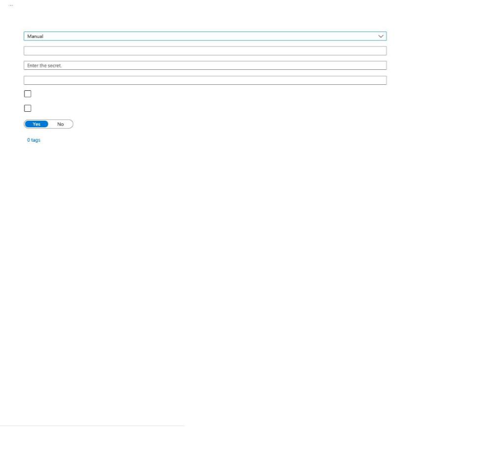

You should now see `PolySwarmApiKey` in the list, with the status **Enabled**. The key
itself is never shown.

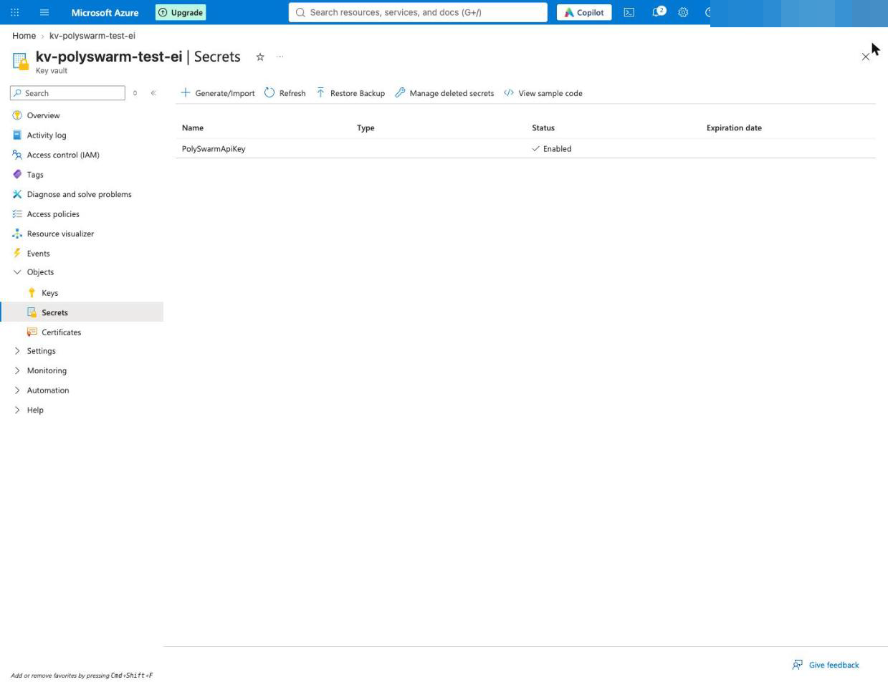

## Step 2. Install PolySwarm from the Content hub

1. In the Defender portal, open **Microsoft Sentinel**, then **Content management**, then
   **Content hub**.
2. Search for **PolySwarm** and select it.
3. Choose **Install**. It takes a minute or two.

This adds the two data connectors, the status workbook, three analytics rules, four
hunting queries and the playbook templates to your workspace. Nothing runs yet.

## Step 3. Connect PolySwarm Hunting

A hunt is a YARA rule you set up on polyswarm.network. Every time a file anywhere on
PolySwarm matches one of your rules, this connector brings that file's hashes into
Microsoft Sentinel. If you have no live hunts yet, the connector has nothing to bring
in, and that is normal.

1. In Microsoft Sentinel, open **Configuration**, then **Data connectors**.
2. Type **PolySwarm** in the search box. You will see two connectors.

   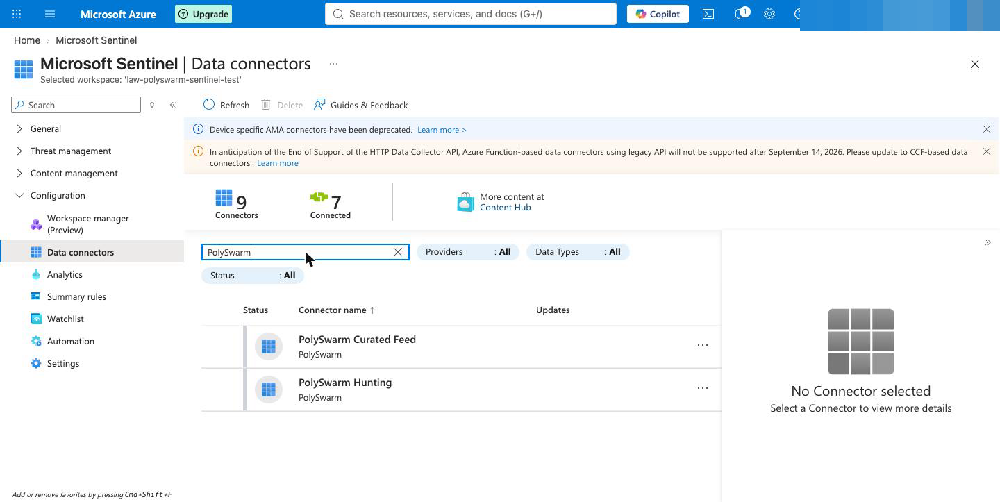

3. Select **PolySwarm Hunting**, then **Open connector page**.

   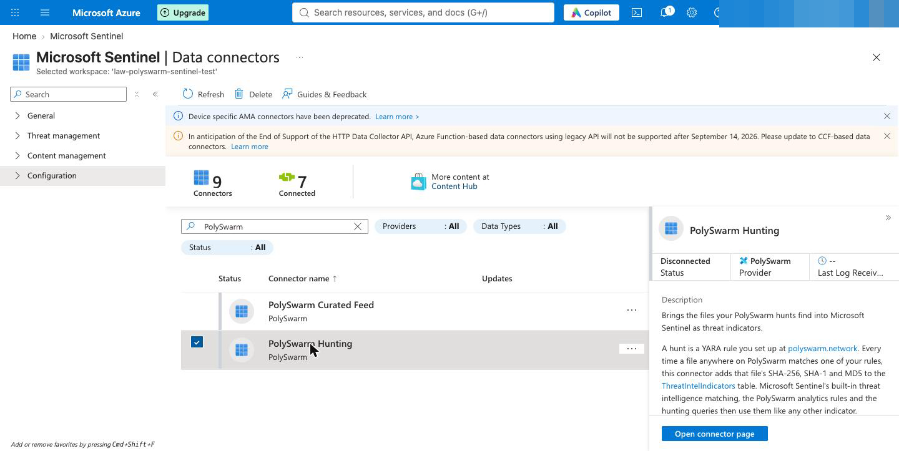

4. Paste your PolySwarm API key into **PolySwarm API Key**.
5. Leave **Community** as `public`, unless your hunts run in a private community. Then
   type its short name instead (lowercase, no spaces). PolySwarm support can tell you
   the short name.
6. Leave **Polling window** at 15 minutes.
7. Select **Connect**. It can take up to a minute, and the page does not show progress
   while it works.

   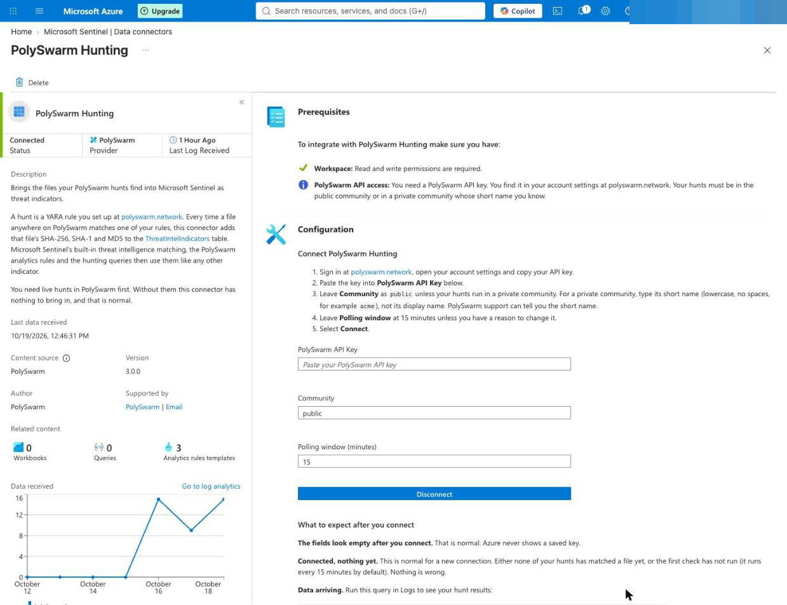

When it works, the button changes to **Disconnect** and the status turns **Connected**.
The key box looks empty again afterwards. That is normal: Azure never shows a saved key.

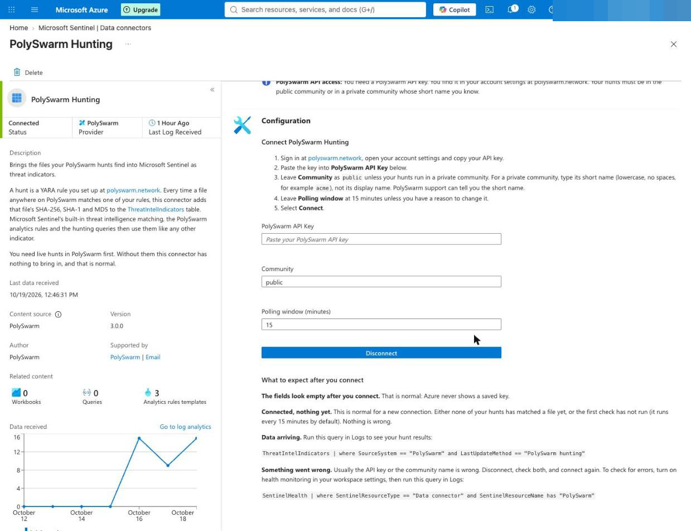

## Step 4. Connect the PolySwarm Curated Feed (if your plan includes it)

The curated feed is a large list of known bad files from PolySwarm, about 500,000
indicators a day (roughly 0.5 GB a day). Microsoft Sentinel charges for the data it
takes in, so check Microsoft Sentinel pricing before you connect it.

1. In **Data connectors**, select **PolySwarm Curated Feed**, then **Open connector
   page**.

   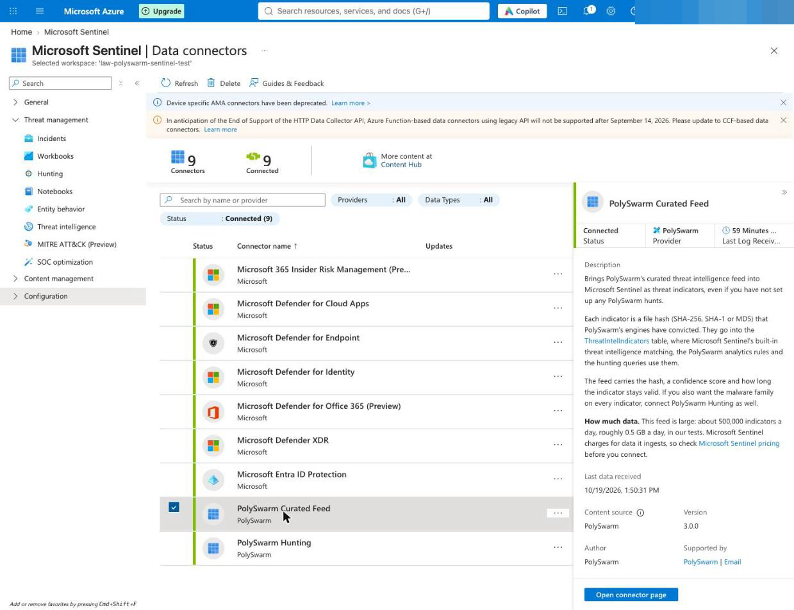

2. Type your PolySwarm account number into **PolySwarm Account Number**.
3. Paste your API key into **PolySwarm API Key**.
4. Choose your feed in **Feed**. If you are not sure, choose **Trust Group 14-day**.
5. Leave **Polling window** at 60 minutes.
6. Select **Connect**.

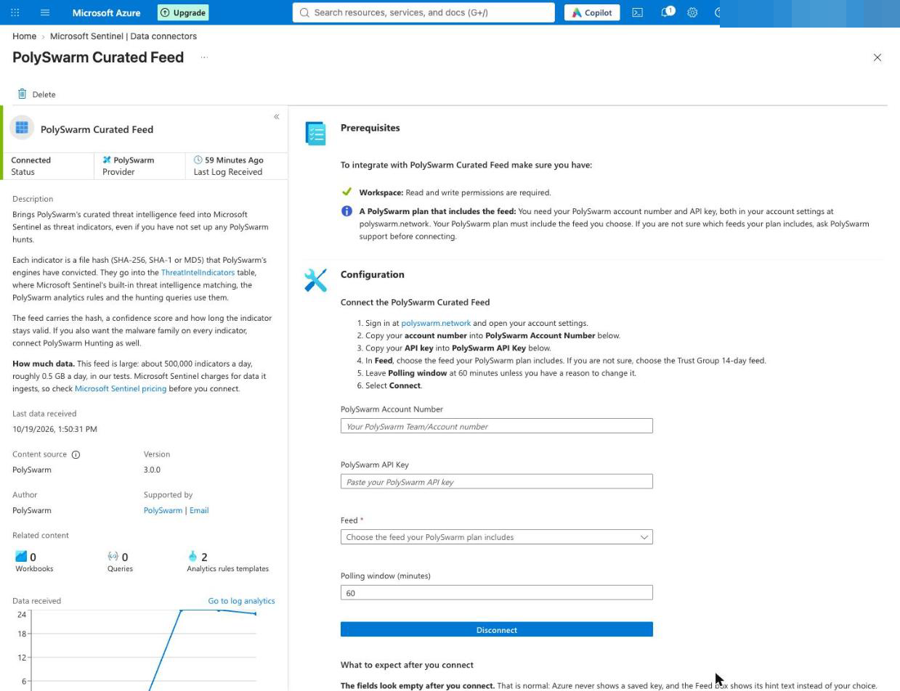

After you connect, the boxes look empty and the Feed box shows its hint text instead
of your choice. That is normal.

When both connectors are connected, both show a green bar in the list:

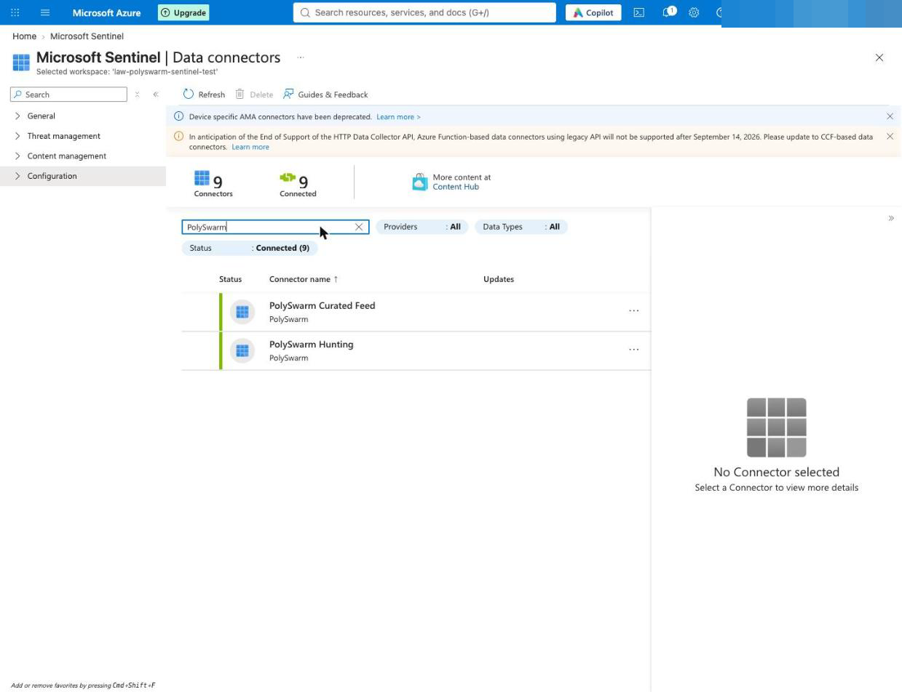

## Step 5. Check the status page

The PolySwarm status workbook shows what has arrived from each connector. It only reads
your own workspace. It never calls PolySwarm.

1. In Microsoft Sentinel, open **Threat management**, then **Workbooks**, then the
   **Templates** tab.
2. Select **PolySwarm status**, then **View template**.

   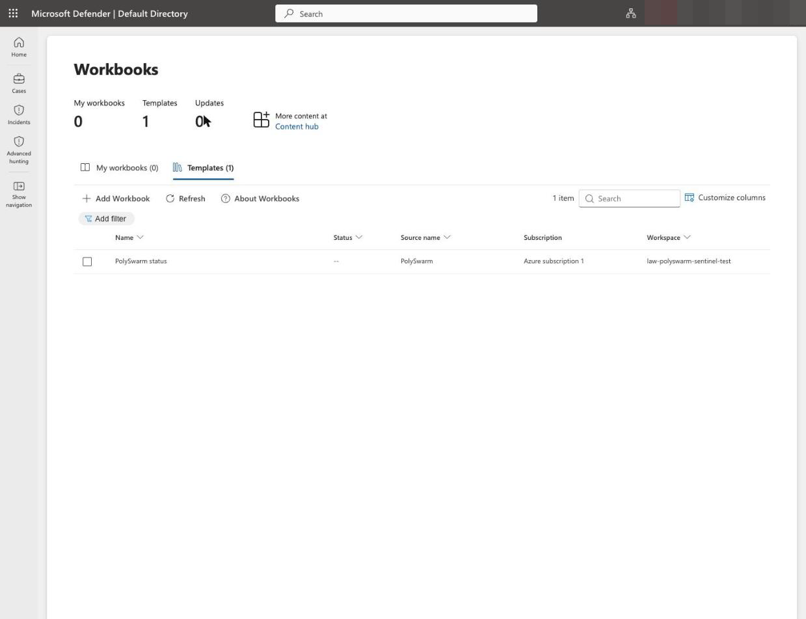

You will see one chart for each connector, when each last delivered something, and
tiles for sandbox results and alerts.

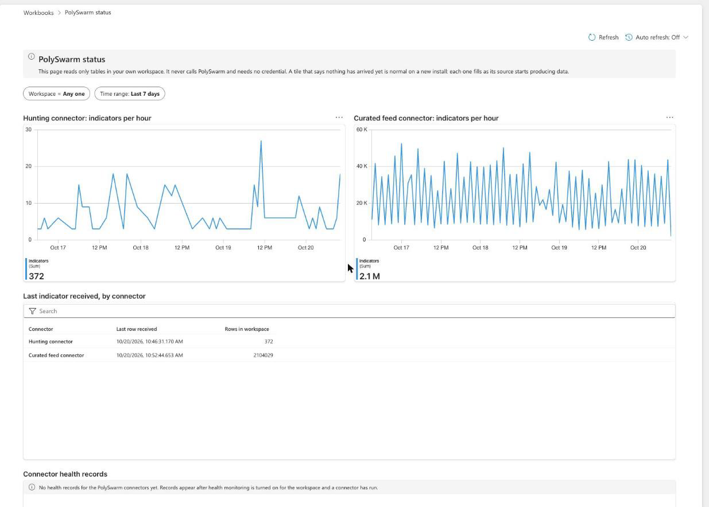

Give it an hour after connecting. A tile that says nothing has arrived yet is normal on
a new install; each one fills as its source starts producing data.

## Step 6. Turn on the analytics rules

The three PolySwarm analytics rules ship switched off, so they never surprise you with
alerts.

1. In Microsoft Sentinel, open **Configuration**, then **Analytics**, then the
   **Rule templates** tab.
2. Search for **PolySwarm**.

   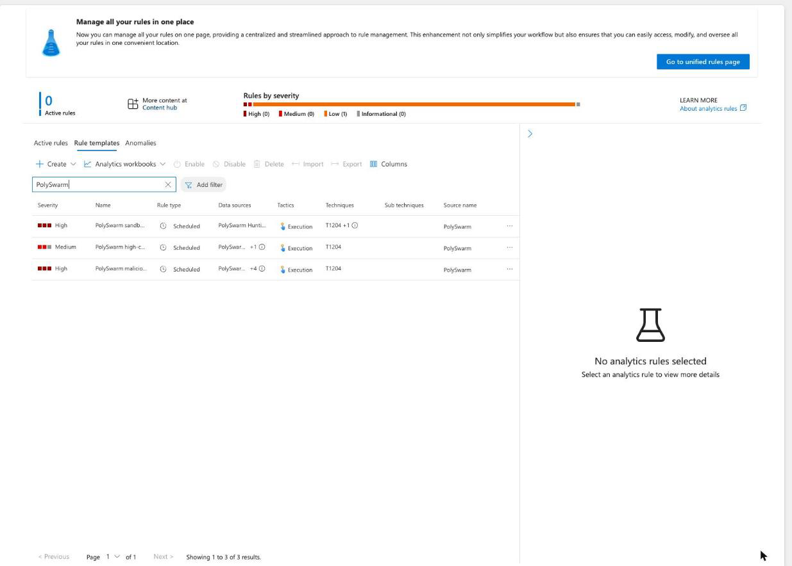

3. Select a rule, then **Create rule**, and go through the pages with the defaults.

   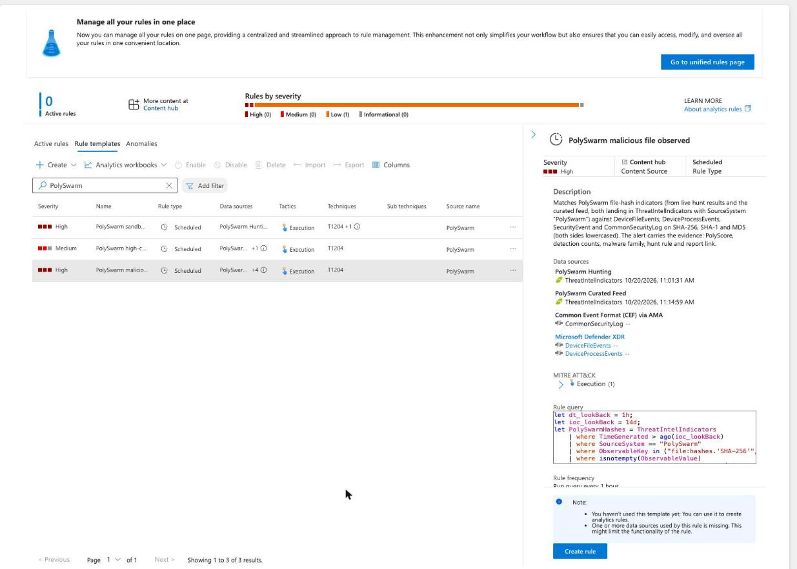

What each rule does:

- **PolySwarm malicious file observed** raises an alert when a file PolySwarm knows is
  bad shows up in your device or security logs.
- **PolySwarm high-confidence hunt hit** raises an alert when one of your hunts matches
  a file PolySwarm is very sure about.
- **PolySwarm sandbox detonation malicious** raises an alert when a PolySwarm sandbox
  playbook finds a file or link is malicious.

## Step 7. Add PolySwarm's verdict to incidents

Playbooks are small automations that run on an incident. The simplest one to start with
is **PolySwarm-Enrich-FileHash-IncidentTriggered**: it looks up every file hash on an
incident and adds PolySwarm's verdict as a comment.

1. In the **Content hub**, open **PolySwarm**, then **Manage**.
2. Find **PolySwarm-Enrich-FileHash-IncidentTriggered**, select it, and choose
   **Configuration**. This takes you to the playbook template.
3. Choose **Create playbook**. On the first page, pick your resource group and region.
   Leave the playbook name as it is.

   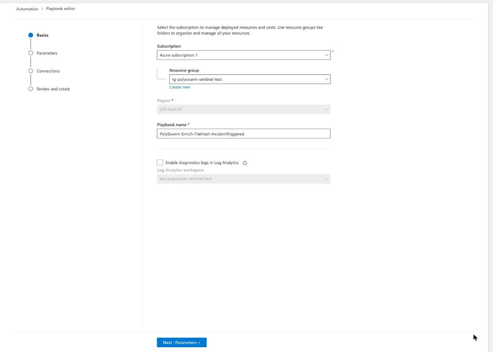

4. On the **Parameters** page, type the name of your Key Vault (the vault from step 1).
   Leave everything else as it is.
5. Go through the remaining pages and choose **Create**.
6. Give the new playbook permission to read the key and to comment on incidents. Your
   Azure administrator can follow the "Grant managed identity role assignments" section
   of the deployment guide (docs/deployment.md).

Then tell Microsoft Sentinel when to run it:

1. Open **Configuration**, then **Automation**, then **Create**, then **Automation rule**.
2. Under **Actions**, choose **Run playbook** and pick the PolySwarm playbook.
3. Save.

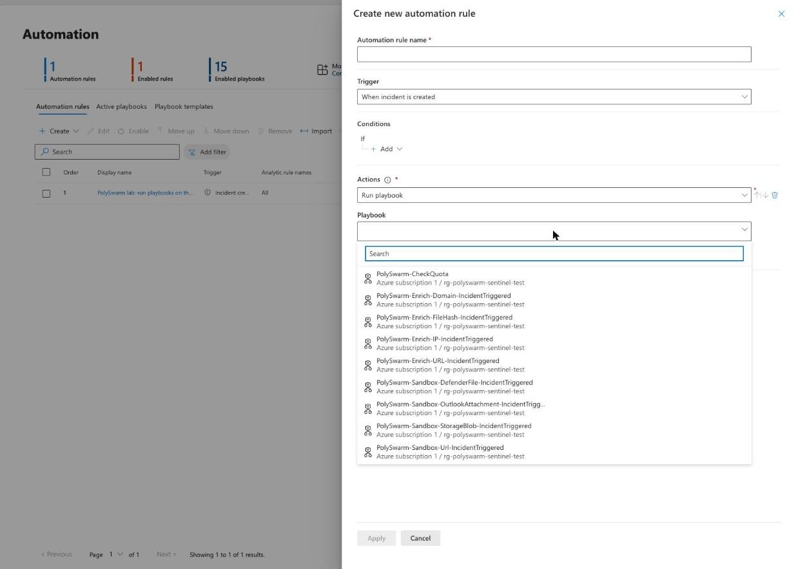

You can also run a playbook by hand on one incident: in the **Incidents** list, select
the incident (do not open it), choose **Run Playbook** in the pane on the right, and
choose **Run playbook** next to the PolySwarm playbook you want.

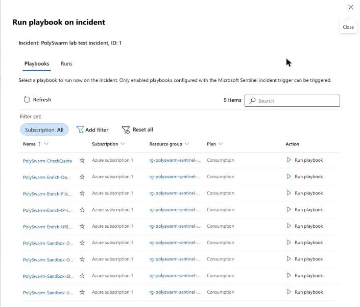

## Step 8. See it work

When the playbook runs, PolySwarm's answer appears on the incident. Open the incident,
select the **Activities** tab, and select the PolySwarm comment to read it in full. (The
short list of activities runs each comment together on one line; the full view keeps
its lines.)

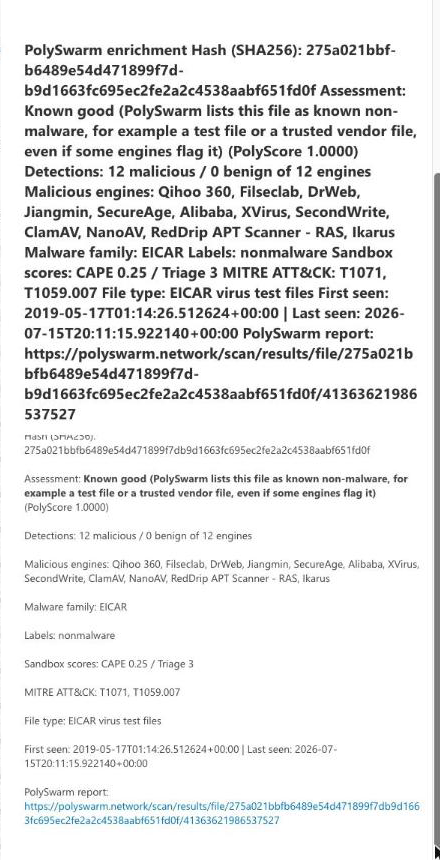

The comment gives the verdict, how many scanning engines called the file malicious,
the malware family when known, and a link to the full PolySwarm report.

## Other playbooks

The solution includes more playbooks: lookups for links, IP addresses and domains, and
sandbox playbooks that run a link or a file in PolySwarm's sandbox and report what it
did. Each one has its own page in the Playbooks folder explaining what it needs.

Two playbooks are in **preview**: the Defender for Endpoint file playbook and the
Outlook attachment playbook. They work in our tests but have not yet been tried on a
live Defender for Endpoint tenant or Exchange Online mailbox. If you try one, please
tell us how it went at support@polyswarm.io.

## If something goes wrong

- **The connector will not connect.** Check that you pasted the whole API key, and that
  the Community is `public` or the short name of a private community, not its display
  name.
- **Connected, but no data after an hour.** For PolySwarm Hunting, check that you have
  at least one live hunt on polyswarm.network. For the curated feed, check that your
  plan includes the feed you chose.
- **A playbook does nothing.** Open the playbook in the Azure portal and look at its
  **Runs history**. A failed Key Vault step almost always means the playbook has not
  been given permission to read the key yet (step 7).
- **Anything else.** Email support@polyswarm.io.
