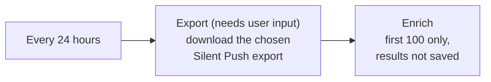

# SilentPush-DomainExportEnrichment-Sample

## Summary

Runs every 24 hours, downloads a Silent Push export of domains that you choose, takes the first 100 domains and bulk-enriches them with Silent Push. It is a starting point to build your own playbook: it does not write the results anywhere.

### Prerequisites

1. A Silent Push API key ([sign up](https://app.silentpush.com)).
2. **Deploy the [Silent Push custom connector](../../Connector/SilentPushCustomConnector) first.** Installing the solution from Content Hub / Marketplace does **not** create it, and the connector does not appear under *Playbook templates*. Deploy it into the **same resource group** where you will create this playbook and keep its name as `SilentPush-API`. Otherwise *Create playbook* fails with "Connector 'SilentPush-API' not found". Deploy it here:

 

### Deployment instructions

1. Click **Deploy to Azure** below. This opens the ARM template deployment wizard.
2. Fill in the parameters:
    * **PlaybookName**: name of the playbook (default `SilentPush-DomainExportEnrichment-Sample`).
    * **CustomConnectorName**: name of the Silent Push custom connector deployed as a prerequisite above (default `SilentPush-API`).

 

### Post-deployment instructions

#### a. Authorize the Silent Push connection

The playbook deploys with an empty API key for the Silent Push connection.

1. Open the deployed Logic App and go to **API connections**.
2. Select the `<PlaybookName>` connection.
3. Go to **General > Edit API connection**.
4. Enter your Silent Push API key and click **Save**.

#### b. Choose the export to process

1. Open the playbook in the **Logic app designer** and select the **Export Domains** action.
2. Fill in **export_category** and **file_name** with the Silent Push export you want to process.
3. Click **Save**.

#### c. Enable the playbook

The playbook is deployed **Disabled**. Enable it once the connection is authorized and the export is set.
