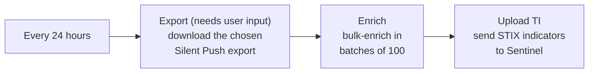

# SilentPush-IPExportEnrichment-Full

## Summary

Runs every 24 hours, downloads a Silent Push export of IPs that you choose, bulk-enriches the IPs in batches of 100 and uploads them to Microsoft Sentinel Threat Intelligence as STIX indicators (Upload Indicators API).

### Prerequisites

1. A Silent Push API key ([sign up](https://app.silentpush.com)).
2. **Deploy the [Silent Push custom connector](../../Connector/SilentPushCustomConnector) first.** Installing the solution from Content Hub / Marketplace does **not** create it, and the connector does not appear under *Playbook templates*. Deploy it into the **same resource group** where you will create this playbook and keep its name as `SilentPush-API`. Otherwise *Create playbook* fails with "Connector 'SilentPush-API' not found". Deploy it here:

 

### Deployment instructions

1. Click **Deploy to Azure** below. This opens the ARM template deployment wizard.
2. Fill in the parameters:
    * **PlaybookName**: name of the playbook (default `SilentPush-IPExportEnrichment-Full`).
    * **CustomConnectorName**: name of the Silent Push custom connector deployed as a prerequisite above (default `SilentPush-API`).
    * **WorkspaceName**: name of the Log Analytics workspace where Microsoft Sentinel is enabled (must be in the same resource group).

 

### Post-deployment instructions

#### a. Authorize the Silent Push connection

The playbook deploys with an empty API key for the Silent Push connection.

1. Open the deployed Logic App and go to **API connections**.
2. Select the `<PlaybookName>` connection.
3. Go to **General > Edit API connection**.
4. Enter your Silent Push API key and click **Save**.

#### b. Microsoft Sentinel connection

The Microsoft Sentinel connection (`azuresentinel-<PlaybookName>`) uses the playbook's managed identity. The deployment grants it the **Microsoft Sentinel Contributor** role on the workspace, so the deploying user needs Owner or User Access Administrator rights on that workspace.

#### c. Choose the export to process

1. Open the playbook in the **Logic app designer** and select the **Export IP** action.
2. Fill in **export_category** and **file_name** with the Silent Push export you want to process.
3. Click **Save**.

#### d. Enable the playbook

The playbook is deployed **Disabled**. Enable it once the connections are authorized and the export is set.
